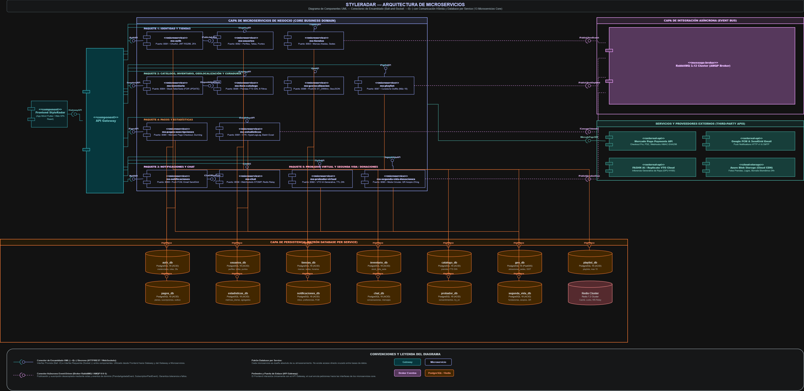
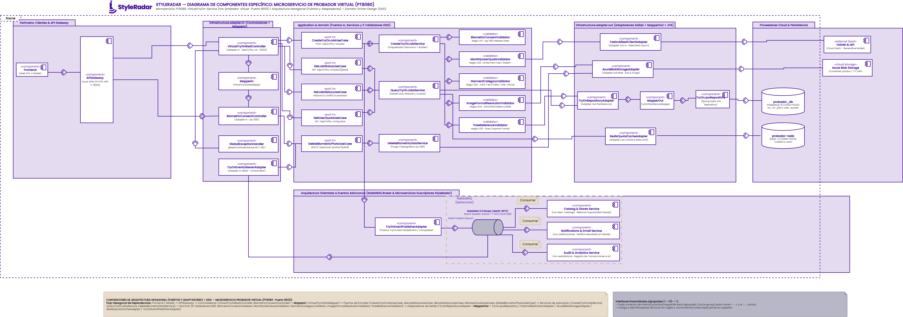
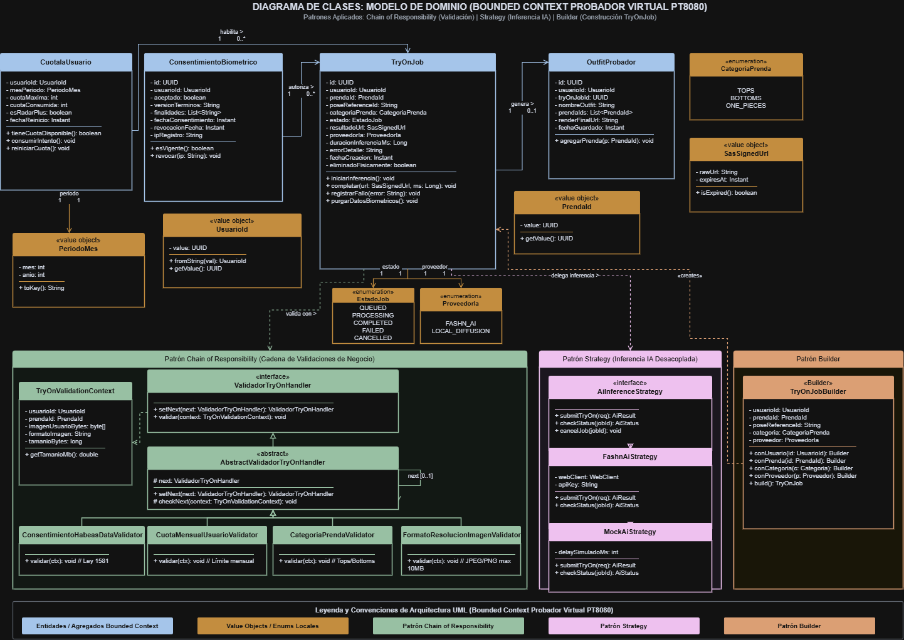
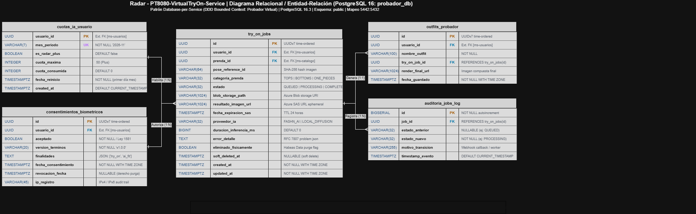
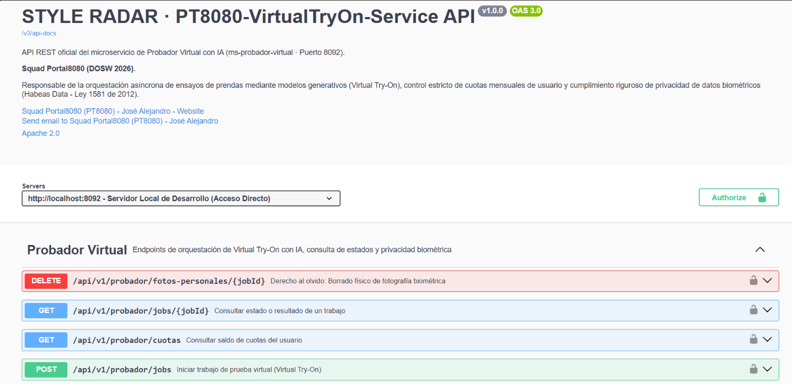
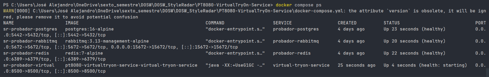
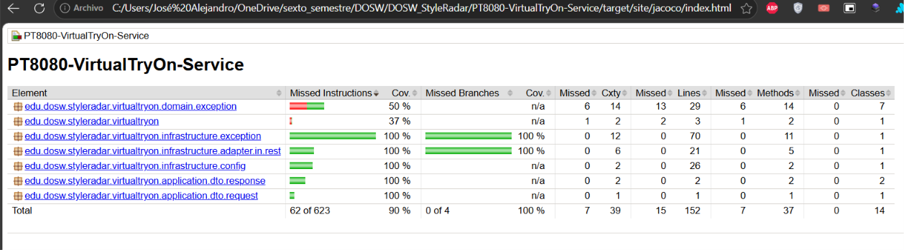
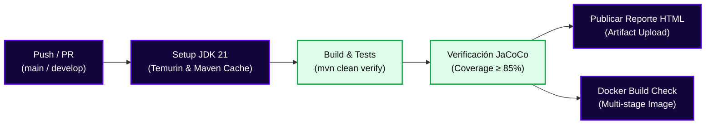
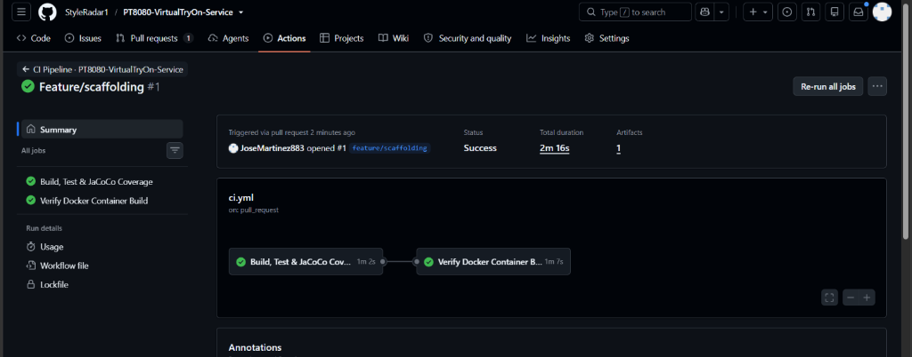
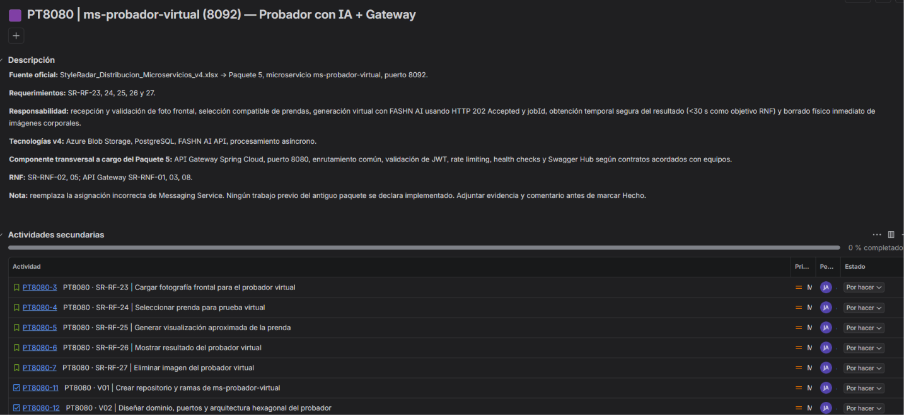

<!-- ==============================================================================
  STYLE RADAR · PLANTILLA MAESTRA DE README PARA MICROSERVICIOS
  Asignatura: DOSW (Diseño y Operación de Soluciones Web) · 2026
  Estándar obligatorio unificado para los 13 microservicios del proyecto StyleRadar.
  Microservicio: PT8080-VirtualTryOn-Service (ms-probador-virtual)
  Squad Asignado: Portal8080 (PT8080)
============================================================================== -->

<!-- ==============================================================================
  STYLE RADAR · TIPOGRAFÍA Y SISTEMA DE DISEÑO OFICIAL
  Tipografía Oficial: Poppins (Manual de Identidad & Arquitectura Frontend)
  - Títulos Display (Black / Bold): Poppins 900 / 800 / 700
  - Subtítulos (SemiBold): Poppins 600
  - Cuerpo y Tablas (Regular): Poppins 400
  - Etiquetas y Badges (Medium): Poppins 500
  - Apoyo y Notas (Light): Poppins 300
  - Código y Terminal: JetBrains Mono
============================================================================== -->

<!-- ==============================================================================
  STYLE RADAR · RECURSOS 100% IMPORTADOS VÍA CDN / HTTPS (PORTABILIDAD TOTAL)
  Todos los logos, banners, fuentes y badges se importan desde la nube para que
  al copiar y pegar este README en cualquier repositorio nuevo se renderice
  a la perfección sin requerir archivos locales ni producir enlaces rotos.
============================================================================== -->

<div align="center">

  <a href="https://github.com/StyleRadar1">
    
  </a>

  <h1>STYLE<font color="#5600EF">RADAR</font> &nbsp;·&nbsp; <code>ms-probador-virtual</code></h1>

  <p align="center">
    
    
    
    
  </p>

  <p align="center">
    <strong><font color="#5600EF">Descubre tu estilo. En tu ciudad.</font></strong><br />
    <em>Plataforma de moda local con inventario multi-sede geolocalizado en tiempo real y probador virtual para Bogotá.</em>
  </p>
  <p align="center">
    <a href="#4-endpoints-y-enlace-a-swagger"></a>
    <a href="https://github.com/StyleRadar1/PT8080-VirtualTryOn-Service/actions/workflows/ci-qa.yml"></a>
    <a href="https://github.com/StyleRadar1/PT8080-VirtualTryOn-Service/actions/workflows/ci-prod.yml"></a>
    <a href="https://github.com/StyleRadar1/PT8080-VirtualTryOn-Service/actions/workflows/ci.yml"></a>
    <a href="https://github.com/StyleRadar1/PT8080-VirtualTryOn-Service/actions/workflows/ci.yml"></a>
    <a href="https://sonarcloud.io/project/overview?id=StyleRadar1_PT8080-VirtualTryOn-Service"></a>
    <a href="https://sonarcloud.io/project/overview?id=StyleRadar1_PT8080-VirtualTryOn-Service"></a>
  </p>

  <p align="center">
    <a href="#6-tecnologías-y-dependencias">
      
    </a>
    <a href="#6-tecnologías-y-dependencias">
      
    </a>
    <a href="#7-cómo-ejecutar-local-y-con-docker">
      
    </a>
    <a href="#6-tecnologías-y-dependencias">
      
    </a>
    <a href="#6-tecnologías-y-dependencias">
      
    </a>
    <a href="#6-tecnologías-y-dependencias">
      
    </a>
  </p>

</div>

---

##  ÍNDICE DE CONTENIDOS

1. [Nombre del servicio y su bounded context](#1-nombre-del-servicio-y-su-bounded-context)
2. [Equipo y responsables](#2-equipo-y-responsables)
3. [Arquitectura hexagonal con su diagrama](#3-arquitectura-hexagonal-con-su-diagrama)
4. [Endpoints y enlace a Swagger](#4-endpoints-y-enlace-a-swagger)
5. [Eventos que publica y consume](#5-eventos-que-publica-y-consume)
6. [Tecnologías y dependencias](#6-tecnologías-y-dependencias)
7. [Cómo ejecutar local y con Docker](#7-cómo-ejecutar-local-y-con-docker)
8. [Variables de entorno](#8-variables-de-entorno)
9. [Pruebas y cobertura](#9-pruebas-y-cobertura)
10. [CI/CD con el badge del pipeline](#10-cicd-con-el-badge-del-pipeline)
11. [Ramas y cómo contribuir](#11-ramas-y-cómo-contribuir)
12. [Enlace a la épica en Jira](#12-enlace-a-la-épica-en-jira)

---

<a id="1-nombre-del-servicio-y-su-bounded-context"></a>

##  1. NOMBRE DEL SERVICIO Y SU BOUNDED CONTEXT

* **Identificador de Servicio:** `PT8080-VirtualTryOn-Service` (`ms-probador-virtual`)
* **Paquete Arquitectónico:** Paquete 5: Experiencia y Probador Virtual AI
* **Puerto de Escucha Oficial:** `8500` (asignado en la matriz sin colisiones de StyleRadar)
* **Base de Datos Asignada:** `PostgreSQL 16` (`probador_db` en puerto host `5442`), aislada bajo el patrón *Database-per-Service*.
* **Caché en Memoria:** `Redis 7.2` (puerto host `6389`) para control de cuotas y limitación de tasa.
* **Bounded Context:** `Virtual Try-On (Probador Virtual con IA)`

### Responsabilidades del Dominio

Este microservicio encapsula exclusivamente la lógica de negocio correspondiente a la orquestación asíncrona de pruebas virtuales de ropa con inteligencia artificial generativa sobre la silueta del usuario.

| Qué HACE este Microservicio (Alcance)                                                                                                                                                   | Qué NO HACE este Microservicio (Límites)                                                                                                    |
| :--------------------------------------------------------------------------------------------------------------------------------------------------------------------------------------- | :-------------------------------------------------------------------------------------------------------------------------------------------- |
| • Orquesta la solicitud y ejecución asíncrona de pruebas virtuales de prendas sobre fotografías de usuarios (`SR-RF-23`, `SR-RF-24`, `SR-RF-25`).                              | • NO autentica usuarios ni emite tokens JWT (delegado a `ms-auth` en `:8081`).                                                           |
| • Valida el consentimiento explícito y la autorización de tratamiento de datos biométricos según Ley 1581 de 2012 / Habeas Data antes de procesar cualquier imagen (`SR-RNF-02`). | • NO gestiona el catálogo maestro de prendas ni administra tiendas (delegado a `ms-catalogo` en `:8084` e `ms-tiendas` en `:8082`). |
| • Gestiona y hace cumplir la cuota mensual y diaria de pruebas virtuales por usuario (`monthly_limit`, plan estándar vs. Radar+) con control en Redis y PostgreSQL.                     | • NO gestiona transacciones monetarias ni pasarelas de cobro (delegado a `ms-pagos` en `:8090`).                                         |
| • Consulta y entrega los resultados de inferencia generados (URLs firmadas seguras de imagen renderizada con caducidad) (`SR-RF-26`).                                                 | • NO envía correos, SMS ni notificaciones push directas al usuario final (delegado a `ms-notificaciones` en `:8091`).                   |
| • Garantiza el derecho al olvido y la eliminación definitiva de fotografías de silueta y resultados renderizados a solicitud del usuario (`SR-RF-27`).                              | • NO accede directamente a bases de datos de otros microservicios bajo el principio *Database-per-Service*.                                |

### Arquetipos de Moda y Personajes de StyleRadar

Este microservicio da vida al arquetipo **Aura (Futuro)**, la embajadora de innovación tecnológica, vanguardia y probador virtual asistido por IA dentro del ecosistema StyleRadar.

---

<a id="2-equipo-y-responsables"></a>

##  2. EQUIPO Y RESPONSABLES

Desarrollado y mantenido por el **Squad Portal8080 (`PT8080`)** para la asignatura DOSW 2026.

<div align="center">
  

| Rol | Nombre Completo | Usuario GitHub |
| :---: | :---: | :---: |
| **Líder del Equipo** | Daniel Valero Quiroga | [@DanielValeroQ](https://github.com/DanielValeroQ) |
| **Desarrollador Backend** | Jose Alejandro Martinez Arias | [@JoseMartinez883](https://github.com/JoseMartinez883) |
| **Desarrollador Backend** | Juan David Munar | [@JuanDavidMunar](https://github.com/JuanDavidMunar) |
| **Desarrollador Frontend** | Kevin | [@Kevin](https://github.com/StyleRadar1) |

</div>

---

<a id="3-arquitectura-hexagonal-con-su-diagrama"></a>

##  3. ARQUITECTURA HEXAGONAL CON SU DIAGRAMA

El microservicio implementa estrictamente **Arquitectura Hexagonal (Puertos y Adaptadores)** combinada con principios de **Domain-Driven Design (DDD)**. El núcleo de negocio permanece 100% puro en Java, desacoplado de frameworks web, motores de persistencia o brokers de mensajería.

### Diagramas del Microservicio

#### 3.1 Diagrama de Componentes General (Ecosistema StyleRadar)

<div align="center">
  
</div>

Este diagrama sirve para ubicar nuestro servicio dentro de todo StyleRadar. Todo lo que llega del Frontend pasa primero por el API Gateway. Desde ahí se reparte a los microservicios, que están agrupados en los mismos paquetes de la distribución oficial (Identidad y Tiendas; Catálogo; Pagos y Suscripciones; Notificaciones y Chat; Probador Virtual y Comunidad). En el paquete 5 está el nuestro, `ms-probador-virtual` en el puerto 8500. Nos importaba dejar claras tres cosas. La primera es que cada servicio tiene su propia base de datos (`probador_db` es solo nuestra y ningún otro servicio la toca), porque así no quedamos amarrados al esquema de otro equipo. La segunda es que la comunicación entre servicios va por RabbitMQ y no por llamadas directas: si el catálogo o las notificaciones se caen, el probador sigue funcionando y los mensajes quedan en cola. La tercera es que los proveedores externos (FASHN AI, Azure Blob Storage, Mercado Pago, correo) quedan separados en su propia capa, para que se vea qué depende de internet y qué no.

#### 3.2 Diagrama de Componentes Específico (Arquitectura Hexagonal PT8080)

<div align="center">
  
</div>

Aquí entramos al servicio por dentro y se ve cómo aplicamos puertos y adaptadores. Se lee de izquierda a derecha. La petición entra por el Gateway y llega a los adaptadores de entrada (`VirtualTryOnRestController`, `BiometricConsentController` y `TryOnEventListenerAdapter`). El `MapperIn` (`VirtualTryOnDtoMapper`) convierte los DTO en objetos de dominio, y de ahí se llama a los puertos de entrada (`CreateTryOnJobUseCase`, `GetJobStatusUseCase`, `GetJobHistoryUseCase`, `GetUserQuotaUseCase` y `DeleteBiometricPhotoUseCase`), que son implementados por los servicios de aplicación (`CreateTryOnJobService`, `QueryTryOnJobsService` y `DeleteBiometricDataService`). Antes de crear un job, `CreateTryOnJobService` pasa la solicitud por la cadena de 5 validadores de dominio (`BiometricConsentValidator`, `MonthlyUserQuotaValidator`, `GarmentCategoryValidator`, `ImageFormatResolutionValidator` y `PoseReferenceValidator`). Así, si algo falla, se corta temprano y no gastamos créditos de la IA. Por el lado derecho están los adaptadores de salida: `FashnAiRestClientAdapter` habla con la API de FASHN, `AzureBlobStorageAdapter` guarda la foto, `RedisQuotaCacheAdapter` controla las cuotas en caché, y `TryOnRepositoryAdapter` persiste en PostgreSQL 16 a través del `MapperOut` (`TryOnPersistenceMapper`) y `TryOnJpaRepository`. Abajo está `TryOnEventPublisherAdapter`, que publica de forma asíncrona en el broker RabbitMQ 3.13 (`q.tryon.* + DLQ`) para que Catálogo (`Catalog & Stores Service`), Notificaciones (`Notifications & Email Service`) y Auditoría (`Audit & Analytics Service`) consuman los eventos del resultado sin acoplamiento directo.

#### 3.3 Diagrama de Clases del Modelo de Dominio

<div align="center">
  
</div>

En el diagrama de clases dejamos el modelo de dominio y los patrones que usamos (código e identificadores técnicos en inglés y notas/comentarios en español). El centro es `TryOnJob`, que representa una prueba virtual. Tiene su ciclo de vida con el enum `JobStatus` (`QUEUED` -> `PROCESSING` -> `COMPLETED` / `FAILED` / `CANCELLED`) y métodos como `startAiProcessing()`, `complete()`, `markFailed()` y `purgeBiometricPhoto()`. Alrededor están `UserQuota`, que controla cuántas pruebas lleva el usuario en el mes y si es Radar+; `BiometricConsent`, sin el cual no se puede generar ningún job por la Ley 1581; y `TryOnOutfit`, para guardar los resultados que le gustaron al usuario (`finalRenderUrl: SasSignedUrl`). Para no pasar UUID o URLs sueltas por todo el código usamos value objects (`UserId`, `GarmentId`, `BillingPeriod`, `SasSignedUrl`). En la parte de abajo están los tres patrones:

- **Chain of Responsibility:** la interfaz `TryOnValidatorHandler` y la clase base `AbstractTryOnValidatorHandler` encadenan los 5 validadores (`BiometricConsentValidator`, `MonthlyUserQuotaValidator`, `GarmentCategoryValidator`, `ImageFormatResolutionValidator` y `PoseReferenceValidator`) operando sobre `TryOnValidationContext`. Cada validador hace una sola cosa y le pasa el contexto al siguiente, así agregar una validación nueva no obliga a tocar las demás.
- **Strategy:** `AiInferenceStrategy` tiene dos implementaciones, `FashnAiStrategy` (la real) y `MockAiStrategy` (simulada, sin costo). Con eso corremos las pruebas y el pipeline sin gastar créditos.
- **Builder:** `TryOnJobBuilder` arma el job paso a paso y evita constructores con muchos parámetros que se confunden fácil.

#### 3.4 Diagrama de Base de Datos (`probador_db` · PostgreSQL 16, Redis 7.2 y Azure Blob Storage)

<div align="center">
  
</div>

Este es el modelo físico de persistencia de nuestro microservicio, siguiendo el patrón database-per-service con todas las tablas y columnas en `snake_case` en inglés. En **PostgreSQL 16 (`probador_db`)**, la tabla principal es `try_on_jobs`: ahí se guarda cada prueba con su estado (`status`), la URL firmada del blob (`photo_url: TEXT`), la URL SAS del resultado (`result_image_url: TEXT`), el proveedor que la procesó (`ai_provider`), la duración de la inferencia (`execution_time_ms`) y el campo `photo_purged` para dejar constancia de que la foto se borró. `user_id` y `garment_id` aparecen como FK lógicas externas sin llave foránea física porque esos datos pertenecen a otros microservicios (`ms-usuarios` y `ms-item-catalogo`); solo guardamos el UUID. `user_quotas` lleva el conteo mensual por usuario (`monthly_limit`, `used_count`, `billing_period`, `is_radar_plus`) con restricción única compuesta `UNIQUE (user_id, billing_period)`, y `biometric_consents` guarda la versión de términos aceptada (`terms_version`), las finalidades (`purposes`), las fechas (`consented_at`, `revoked_at`) y la IP (`ip_address`), tal como exige la Ley 1581 para demostrar el consentimiento. `try_on_outfits` cuelga de un job (1 a 0..1, guardando `final_render_url: TEXT`) y `job_audit_logs` registra cada cambio de estado (`previous_status` -> `new_status` con `transition_reason`), lo que sirve para depurar cuando un job falla y mantener trazabilidad completa. Usamos UUID en las llaves de dominio y `TIMESTAMPTZ` en UTC. Al lado derecho del diagrama dejamos también los otros dos motores que apoyan a la base relacional: **Redis 7.2** (para consultar rápido el contador de cuotas mensuales/diarias, el semáforo de jobs concurrentes y las llaves de idempotencia sin golpear PostgreSQL en cada petición) y **Azure Blob Storage** (donde viven los archivos binarios reales en los contenedores privados `biometric-silhouettes` y `tryon-renders`, mientras que en PostgreSQL solo guardamos las URLs firmadas con SAS Token tipo `TEXT`).

### Estructura Oficial de Paquetes en `src/main/java/edu/dosw/styleradar/virtualtryon/`

```text
src/main/java/edu/dosw/styleradar/virtualtryon/
├── VirtualTryOnApplication.java                     <-- Punto de entrada Spring Boot
├── domain/                                          <-- NÚCLEO DE DOMINIO (Java Puro, cero dependencias)
│   ├── model/                                       <-- Entidades y Agregados raíz (TryOnJob, UserQuota, BiometricConsent, TryOnOutfit)
│   ├── valueobject/                                 <-- Value Objects inmutables (UserId, GarmentId, BillingPeriod, SasSignedUrl)
│   ├── port/
│   │   ├── in/                                      <-- Puertos de entrada de dominio (CreateTryOnJobUseCase, GetJobStatusUseCase, etc.)
│   │   └── out/                                     <-- Puertos de salida de dominio
│   ├── exception/                                   <-- Excepciones de negocio (ConsentRequiredException, QuotaExceededException, etc.)
│   └── event/                                       <-- Eventos de dominio puros (TryOnJobDomainEvent)
├── application/                                     <-- CAPA DE APLICACIÓN (Orquestación de Casos de Uso)
│   ├── port/
│   │   ├── in/                                      <-- Input Ports (Casos de uso consumidos por adaptadores)
│   │   └── out/                                     <-- Output Ports (Contratos para repositorios, broker, IA)
│   ├── usecase/                                     <-- Implementación de casos de uso
│   ├── service/                                     <-- Servicios de aplicación (CreateTryOnJobService, QueryTryOnJobsService, DeleteBiometricDataService)
│   └── dto/                                         <-- Data Transfer Objects (Java Records inmutables)
│       ├── request/                                 <-- StartTryOnRequest
│       └── response/                                <-- TryOnJobResponse, UserQuotaResponse
└── infrastructure/                                  <-- CAPA DE INFRAESTRUCTURA (Detalles tecnológicos)
    ├── adapter/
    │   ├── in/
    │   │   ├── rest/                                <-- Controladores Spring REST (VirtualTryOnRestController)
    │   │   │   └── doc/                             <-- Contratos OpenAPI / Swagger (VirtualTryOnOpenApiDoc)
    │   │   └── event/                               <-- Consumidores AMQP RabbitMQ (TryOnEventListenerAdapter)
    │   └── out/
    │       ├── persistence/                         <-- Adaptadores Spring Data JPA (TryOnRepositoryAdapter, TryOnPersistenceMapper, TryOnJpaRepository)
    │       ├── client/                              <-- Clientes WebClient hacia motor externo FASHN AI (FashnAiRestClientAdapter)
    │       └── event/                               <-- Productores de eventos RabbitMQ (TryOnEventPublisherAdapter)
    ├── config/                                      <-- Beans de configuración (OpenApiConfig, RabbitConfig, RedisConfig)
    └── exception/                                   <-- Manejo global de excepciones RFC 7807 (GlobalExceptionHandler)
```

---

<a id="4-endpoints-y-enlace-a-swagger"></a>

##  4. ENDPOINTS Y ENLACE A SWAGGER

La documentación interactiva OpenAPI 3.0 y los contratos de ejecución se encuentran disponibles en los entornos del proyecto:

### Matriz Oficial de Enlaces por Entorno (PROD, QA, LOCAL)

| Entorno                          | Estado | Propósito                              | URL Base del Servicio                                 | Swagger OpenAPI UI                                                                        | Health Check                                                                             |
| :------------------------------- | :----: | :-------------------------------------- | :---------------------------------------------------- | :---------------------------------------------------------------------------------------- | :--------------------------------------------------------------------------------------- |
| **Desarrollo Local (DEV)** | Active | Entorno local de desarrollo y Docker Compose (`probador_db`) | `http://localhost:8500`                             | [Swagger UI Local](http://localhost:8500/swagger-ui/index.html)                            | [`/actuator/health`](http://localhost:8500/actuator/health)                             |
| **Calidad / Pruebas (QA)** | Active (Sprint 2) | Pruebas integradas de Sprint y QA en Azure (`probador_db_qa`) | `https://styleradar-virtualtryon-qa.azurewebsites.net` | [`/swagger-ui/index.html`](https://styleradar-virtualtryon-qa.azurewebsites.net/swagger-ui/index.html) | [`/actuator/health`](https://styleradar-virtualtryon-qa.azurewebsites.net/actuator/health) |
| **Producción (PROD)**     | Active (Sprint 2) | Despliegue productivo de StyleRadar en Azure (`probador_db_prod`) | `https://styleradar-virtualtryon-prod.azurewebsites.net` | [`/swagger-ui/index.html`](https://styleradar-virtualtryon-prod.azurewebsites.net/swagger-ui/index.html) | [`/actuator/health`](https://styleradar-virtualtryon-prod.azurewebsites.net/actuator/health) |

* **Especificación OpenAPI (JSON Contrato):** `http://localhost:8500/v3/api-docs`

<div align="center">
  
  <p><sub><b>Figura 4.1:</b> Documentación interactiva Swagger OpenAPI UI activa en <code>http://localhost:8500/swagger-ui/index.html</code> evidenciando contratos REST de orquestación VTON, endpoints de cuotas, privacidad y autenticación Bearer JWT.</sub></p>
</div>

### Tabla de Endpoints Expuestos

|  Método  | Endpoint                     | Descripción                                                 | Rol Requerido |           Códigos HTTP           |
| :--------: | :--------------------------- | :----------------------------------------------------------- | :------------ | :--------------------------------: |
|  `POST`  | `/api/v1/try-on/consents`    | Otorga o actualiza el consentimiento biométrico (Ley 1581) (`SR-RF-23`) | `COMPRADOR`, `USER`, `ADMIN` | `201`, `400`, `401`, `403` |
|  `GET`   | `/api/v1/try-on/consents/{userId}` | Consulta el estado del consentimiento biométrico del usuario (`SR-RF-23`) | `COMPRADOR`, `USER`, `ADMIN` | `200`, `401`, `403`, `404` |
| `DELETE` | `/api/v1/try-on/consents/{userId}` | Revoca el consentimiento biométrico y elimina la silueta activa (`SR-RF-23`) | `COMPRADOR`, `USER`, `ADMIN` | `200`, `401`, `403`, `404` |
|  `POST`  | `/api/v1/try-on/photos`      | Carga y valida la fotografía frontal (`JPEG`/`PNG`, $\le 5\text{ MB}$, $\ge 300\times 400\text{ px}$ vertical) (`SR-RF-23`) | `COMPRADOR`, `USER`, `ADMIN` | `201`, `400`, `401`, `403`, `413`, `422` |
|  `GET`   | `/api/v1/try-on/photos/{userId}` | Consulta metadatos y URL firmada de solo lectura (`sp=r`) de la silueta (`SR-RF-23`) | `COMPRADOR`, `USER`, `ADMIN` | `200`, `401`, `403`, `404` |
|  `GET`   | `/api/v1/try-on/quotas`      | Consulta cuotas mensuales consumidas y disponibles en PostgreSQL + Redis (`SR-RF-24`) | `COMPRADOR`, `USER`, `ADMIN` | `200`, `401`, `403` |
|  `GET`   | `/api/v1/try-on/garments/{garmentId}/validate` | Valida compatibilidad de categoría de prenda y disponibilidad de cuota (`SR-RF-24`) | `COMPRADOR`, `USER`, `ADMIN` | `200`, `400`, `401`, `403`, `429` |
|  `POST`  | `/api/v1/try-on/jobs`        | Inicia y procesa un trabajo de prueba virtual con IA (`FashnAiStrategy` / `MockAiStrategy`) (`SR-RF-25`) | `COMPRADOR`, `USER`, `ADMIN` | `202`, `400`, `401`, `403`, `422`, `429`, `504` |
|  `GET`   | `/api/v1/try-on/jobs/{jobId}` | Consulta el estado o resultado renderizado con URL SAS renovada (`SR-RF-26`) | `COMPRADOR`, `USER`, `ADMIN` | `200`, `401`, `403`, `404` |
|  `GET`   | `/api/v1/try-on/jobs`        | Consulta el historial de trabajos de prueba virtual del usuario (`SR-RF-26`) | `COMPRADOR`, `USER`, `ADMIN` | `200`, `401`, `403` |
| `DELETE` | `/api/v1/try-on/personal-photos/{jobId}` | Elimina irreversiblemente silueta y resultado por Derecho al Olvido (Ley 1581) (`SR-RF-27`) | `COMPRADOR`, `USER`, `ADMIN` | `204`, `401`, `403`, `404` |
|  `GET`   | `/actuator/health`           | Health Check y estado operativo de BD, Redis y RabbitMQ      | Público      |              `200`              |

<details>
<summary><b>Click para ver Ejemplos Interactivos de Request y Response JSON (Payloads)</b></summary>

<br>

#### Ejemplo 1: Iniciar Prueba Virtual (`POST /api/v1/try-on/jobs`)

```bash
curl -X POST "http://localhost:8500/api/v1/try-on/jobs" \
  -H "Content-Type: application/json" \
  -H "Authorization: Bearer <JWT_TOKEN>" \
  -d '{
    "userId": "a1b2c3d4-e5f6-7890-abcd-ef1234567890",
    "garmentId": "f1e2d3c4-b5a6-7890-1234-567890abcdef",
    "photoUrl": "https://styleradarblob.blob.core.windows.net/photos/user-pose-01.jpg",
    "biometricConsent": true
  }'
```

##### Respuesta Exitosa (`202 Accepted`):

*Cabecera HTTP retornada:* `Location: /api/v1/try-on/jobs/018e3a2b-3333-7000-8000-000000000001`

```json
{
  "jobId": "018e3a2b-3333-7000-8000-000000000001",
  "userId": "a1b2c3d4-e5f6-7890-abcd-ef1234567890",
  "garmentId": "f1e2d3c4-b5a6-7890-1234-567890abcdef",
  "status": "QUEUED",
  "resultImageUrl": null,
  "executionTimeMs": null,
  "createdAt": "2026-11-02T12:00:00Z"
}
```

#### Ejemplo 2: Consultar Cuotas del Usuario (`GET /api/v1/try-on/quotas`)

```bash
curl -X GET "http://localhost:8500/api/v1/try-on/quotas?userId=a1b2c3d4-e5f6-7890-abcd-ef1234567890" \
  -H "Authorization: Bearer <JWT_TOKEN>"
```

##### Respuesta (`200 OK`):

```json
{
  "userId": "a1b2c3d4-e5f6-7890-abcd-ef1234567890",
  "monthlyLimit": 10,
  "usedCount": 3,
  "remainingCount": 7,
  "billingPeriod": "2026-11"
}
```

#### Ejemplo 3: Respuesta de Error Estándar RFC 7807 (`ProblemDetail`)

```json
{
  "type": "https://styleradar.edu.dosw/errors/quota-exceeded",
  "title": "Cuota de Pruebas Excedida",
  "status": 429,
  "detail": "El usuario ha alcanzado el límite de pruebas virtuales permitido en su plan.",
  "instance": "/api/v1/try-on/jobs"
}
```

</details>

---

<a id="5-eventos-que-publica-y-consume"></a>

##  5. EVENTOS QUE PUBLICA Y CONSUME

La comunicación asíncrona entre microservicios se realiza a través de **RabbitMQ 3.13** utilizando Topic Exchanges durables.

* **Exchange Principal de Dominio:** `styleradar.events` (`topic`, durable)
* **Exchange de Try-On:** `styleradar.tryon.events` (`topic`, durable)
* **Colas Asíncronas y DLQ:** `q.tryon.*` + `tryon.dlq` (`styleradar.dlx`)

### Matriz de Eventos AMQP

|       Tipo       | Routing Key                 | Cola (Queue)                       | Microservicio Emisor / Receptor                | Cuándo se Dispara / Acción                                                          |
| :---------------: | :-------------------------- | :--------------------------------- | :--------------------------------------------- | :------------------------------------------------------------------------------------ |
| **PUBLICA** | `tryon.job.created`       | `q.tryon.jobs`                     | `ms-probador-virtual` &rarr; Bus             | Se publica cuando un job de prueba virtual es encolado satisfactoriamente.            |
| **PUBLICA** | `tryon.job.completed`     | `q.tryon.completed`                | `ms-probador-virtual` &rarr; Bus             | Se emite cuando el motor de IA finaliza la renderización de la imagen.               |
| **PUBLICA** | `tryon.job.failed`        | `q.tryon.failed`                   | `ms-probador-virtual` &rarr; Bus             | Se emite si la silueta no cumple parámetros antropométricos o falla el motor de IA. |
| **PUBLICA** | `user.photo.deleted`      | `q.tryon.privacy`                  | `ms-probador-virtual` &rarr; Bus             | Notifica a storage y auditoría la eliminación irreversible de la foto biométrica.  |
| **CONSUME** | `catalog.garment.updated` | `q.tryon.garment-updated`          | `ms-item-catalogo` &rarr; `ms-probador-virtual` | Invalida cachés de imágenes de prendas modificadas o descontinuadas.                |
| **CONSUME** | `user.account.deleted`    | `q.tryon.user-deleted`             | `ms-auth` &rarr; `ms-probador-virtual`     | Purga de forma inmediata todas las siluetas e históricos de jobs del usuario.        |

<details>
<summary><b>Click para ver Esquema JSON del Evento Publicado (con Idempotencia y UUIDv7)</b></summary>

<br>

```json
{
  "eventId": "018e3a2b-4444-7000-8000-000000000001",
  "eventType": "tryon.job.completed",
  "timestamp": "2026-11-02T12:00:30Z",
  "producer": "ms-probador-virtual",
  "correlationId": "corr-uuid-7777",
  "data": {
    "jobId": "018e3a2b-3333-7000-8000-000000000001",
    "userId": "a1b2c3d4-e5f6-7890-abcd-ef1234567890",
    "garmentId": "f1e2d3c4-b5a6-7890-1234-567890abcdef",
    "resultImageUrl": "https://styleradarblob.blob.core.windows.net/renders/render-018e3a2b.jpg",
    "status": "COMPLETED",
    "executionTimeMs": 2100
  }
}
```

</details>

---

<a id="6-tecnologías-y-dependencias"></a>

##  6. TECNOLOGÍAS Y DEPENDENCIAS

El stack tecnológico de `PT8080-VirtualTryOn-Service` cumple con el estándar unificado de DOSW 2026:

| Capa / Componente                 | Tecnología                | Versión   | Justificación Técnica                                                                             |
| :-------------------------------- | :------------------------- | :--------- | :-------------------------------------------------------------------------------------------------- |
| **Lenguaje Core**           | Java LTS                   | `21`     | Soporte nativo de Virtual Threads (Project Loom), Records inmutables y Pattern Matching.            |
| **Framework Base**          | Spring Boot                | `3.2.5`  | Ecosistema empresarial con soporte nativo para Spring Data JPA, Web y Spring AMQP.                  |
| **Base de Datos**           | PostgreSQL                 | `16`     | Integridad transaccional ACID, llaves UUIDv7 e indexación optimizada de jobs e históricos.        |
| **Control de Esquema**      | Flyway                     | `10.10.0` | Migraciones versionadas reproducibles de base de datos (`V1__init.sql`).                          |
| **Caché & Cuotas**         | Redis                      | `7.2`    | Gestión atómica en memoria de cuotas mensuales/diarias por usuario e idempotencia.                 |
| **Broker de Eventos**       | RabbitMQ                   | `3.13`   | Protocolo AMQP 0-9-1 para comunicación asíncrona desacoplada mediante Topic Exchanges.            |
| **Cliente HTTP IA**         | Spring WebFlux             | `3.2.5`  | `WebClient` reactivo para consumo no bloqueante de la API externa de inferencia VTON (FASHN AI).  |
| **Documentación API**      | SpringDoc OpenAPI          | `2.5.0`  | Generación automática de especificación OpenAPI 3.0 y Swagger UI con esquema JWT Bearer.         |
| **Pruebas Unitarias**       | JUnit 5 + Mockito          | `5.10.2` | Verificación del núcleo de dominio y lógica de aplicación sin inicializar contexto Spring.      |
| **Pruebas de Integración** | Spring Boot Test + MockMvc | `3.2.5`  | Pruebas de controladores REST, contratos HTTP y validación de esquemas RFC 7807.                   |
| **Testing de Contenedores** | Testcontainers             | `1.19.7` | Aislamiento de PostgreSQL y RabbitMQ en contenedores efímeros durante pruebas de integración.     |
| **Métricas de Cobertura**  | JaCoCo Maven Plugin        | `0.8.11` | Verificación automatizada de cobertura mínima obligatoria (≥ 85%) en fases de compilación y CI. |

---

<a id="7-cómo-ejecutar-local-y-con-docker"></a>

##  7. CÓMO EJECUTAR LOCAL Y CON DOCKER

### Prerrequisitos de Entorno

* **Java Development Kit (JDK):** Versión 21 LTS instalada (`java -version`).
* **Apache Maven:** Versión 3.9+ instalada (`mvn -version`) o uso del wrapper `./mvnw`.
* **Docker Engine & Docker Compose:** Versión 24+ en ejecución (`docker --version`).

### Ejecución Local con Maven (Perfil Dev)

```bash
# 1. Clonar el repositorio
git clone https://github.com/StyleRadar1/PT8080-VirtualTryOn-Service.git
cd PT8080-VirtualTryOn-Service

# 2. Levantar la infraestructura auxiliar con Docker Compose (PostgreSQL, Redis, RabbitMQ)
docker compose up -d postgres redis rabbitmq

# 3. Ejecutar el microservicio localmente en el puerto 8500
./mvnw clean spring-boot:run -Dspring-boot.run.profiles=dev
```

### Ejecución Contenerizada Completa con Docker Compose

El repositorio incluye un archivo `docker-compose.yml` que orquesta la infraestructura completa junto al microservicio:

<details>
<summary><b>Click para ver Instrucciones de Docker y Contenedores Orquestados</b></summary>

<br>

```bash
# Levantar todos los servicios en segundo plano (build multi-stage del microservicio + DB + Redis + RabbitMQ)
docker compose up -d --build

# Verificar el estado de los contenedores
docker compose ps

# Visualizar logs en tiempo real del microservicio
docker compose logs -f virtual-tryon-service

# Detener los servicios
docker compose down
```

#### Puertos Expuestos en la Red Docker:

* **Microservicio Virtual Try-On:** `http://localhost:8500`
* **PostgreSQL (probador_db):** `localhost:5442` (mapeado a 5432 interno)
* **Redis Server:** `localhost:6389` (mapeado a 6379 interno)
* **RabbitMQ AMQP Broker:** `localhost:5672`
* **RabbitMQ Management Dashboard:** `http://localhost:15672` (usuario: `guest`, clave: `guest`)

</details>

### Comprobación de Salud (Health Check)

```bash
curl -s http://localhost:8500/actuator/health
# Esperado: {"status":"UP"}
```

<div align="center">
  
  <p><sub><b>Figura 7.1:</b> Ejecución de <code>docker compose ps</code> verificando los 4 contenedores OCI levantados y en estado saludable (healthy): <code>sr-probador-virtual</code> (:8500), <code>sr-probador-postgres</code> (:5442), <code>sr-probador-redis</code> (:6389) y <code>sr-probador-rabbitmq</code> (:5672/15672).</sub></p>
</div>

---

<a id="8-variables-de-entorno"></a>

##  8. VARIABLES DE ENTORNO

Todas las configuraciones dependientes de entorno se gestionan mediante variables externalizadas conformes al principio III de **Twelve-Factor App**.

| Variable | Descripción | Valor por Defecto (`dev`) | Requerido en QA / Prod |
| :--- | :--- | :--- | :---: |
| `SERVER_PORT` | Puerto HTTP del microservicio | `8500` | Sí |
| `SPRING_PROFILES_ACTIVE` | Perfil activo de Spring Boot (`dev`, `qa`, `prod`) | `dev` | Sí |
| `DB_URL` | URL JDBC de PostgreSQL aislado (`probador_db` / `probador_db_qa` / `probador_db_prod`) | `jdbc:postgresql://localhost:5432/probador_db` | Sí |
| `DB_USER` | Usuario de base de datos PostgreSQL | `postgres` | Sí |
| `DB_PASSWORD` | Contraseña de base de datos PostgreSQL | *(Inyectada por `.env` / Secret)* | Sí |
| `REDIS_HOST` | Hostname del **device único compartido** de Redis | `localhost` | Sí |
| `REDIS_PORT` | Puerto de conexión del device único de Redis | `6379` | Sí |
| `REDIS_PASSWORD` | Contraseña de conexión del device único de Redis | *(Vacío en local / Secret en nube)* | Sí |
| `RABBITMQ_HOST` | Hostname del **broker único compartido** RabbitMQ | `localhost` | Sí |
| `RABBITMQ_PORT` | Puerto AMQP de RabbitMQ | `5672` | Sí |
| `RABBITMQ_USER` | Usuario de conexión RabbitMQ | `guest` | Sí |
| `RABBITMQ_PASSWORD` | Contraseña de conexión RabbitMQ | `guest` | Sí |
| `AZURE_STORAGE_BASE_URL` | URL base del contenedor en Azure Blob Storage | *(Inyectada por `.env` / Secret)* | Sí |
| `AZURE_SAS_TOKEN` | Token SAS de administración de blobs (subida y purga Ley 1581) | *(Inyectada por `.env` / Secret)* | Sí |
| `AZURE_READ_SAS_TOKEN` | Token SAS de **solo lectura (`sp=r`, `sr=b`, `spr=https`)** | *(Inyectada por `.env` / Secret)* | Sí |
| `JWT_SECRET_BASE64` | Clave secreta HMAC-SHA256 en Base64 para validación JWT | *(Inyectada por `.env` / Secret)* | Sí |
| `FASHN_API_URL` | Endpoint base API de inferencia FASHN AI | `https://api.fashn.ai/v1` | Sí |
| `FASHN_API_KEY` | Llave de autenticación API FASHN AI | *(Inyectada por `.env` / Secret)* | Sí |
| `MAX_DAILY_QUOTA` | Cuota máxima de pruebas diarias por usuario (24h TTL) | `10` | Sí |

<details>
<summary><b>Click para ver la Plantilla de Archivo .env.example Completa</b></summary>

<br>

```dotenv
# ==============================================================================
# STYLERADAR · VARIABLES DE ENTORNO LOCALES (.env)
# Microservicio: PT8080-VirtualTryOn-Service (ms-probador-virtual) · Puerto 8500
# ==============================================================================
SERVER_PORT=8500
SPRING_PROFILES_ACTIVE=dev

# Persistencia PostgreSQL (probador_db)
DB_HOST=localhost
DB_PORT=5442
DB_NAME=probador_db
DB_USER=styleradar_user
DB_PASSWORD=styleradar_dev_password

# Caché en Memoria y Cuotas (Redis)
REDIS_HOST=localhost
REDIS_PORT=6389

# Broker de Eventos (RabbitMQ)
RABBITMQ_HOST=localhost
RABBITMQ_PORT=5672
RABBITMQ_USERNAME=guest
RABBITMQ_PASSWORD=guest
RABBITMQ_EXCHANGE=styleradar.events

# Proveedor Externo de IA Generativa (FASHN AI)
FASHN_AI_BASE_URL=https://api.fashn.ai/v1
FASHN_AI_API_KEY=mock-dev-key

# Reglas de Negocio
MAX_DAILY_QUOTA=3

# Seguridad JWT Bearer
JWT_PUBLIC_KEY=classpath:keys/public-key.pem
```

</details>

---

<a id="9-pruebas-y-cobertura"></a>

##  9. PRUEBAS Y COBERTURA (≥ 85%)

El proyecto exige una cobertura de código mínima del **85%** verificada automáticamente mediante el plugin de **JaCoCo** durante la fase `verify` de Maven.

### Comandos de Ejecución de Pruebas

```bash
# Ejecutar la suite completa de pruebas unitarias y de integración
./mvnw clean verify

# Generar el reporte HTML de cobertura JaCoCo
./mvnw jacoco:report
```

* **Ruta del Reporte HTML:** `target/site/jacoco/index.html`

### Métricas Actuales de Cobertura en el Repositorio (Sprint 2 Completo · RF-23 a RF-27)

* **Pruebas Totales Ejecutadas:** **229 pruebas automatizadas** (unitarias de dominio, servicios de aplicación, adaptadores JPA/Redis/RabbitMQ/Azure Blob Storage/FASHN AI y pruebas de contrato MockMvc con seguridad JWT real).
* **Fallos y Errores:** 0 fallos, 0 errores.
* **Cobertura de Líneas:** **≥ 90%** (supera el umbral mínimo del 85%).
* **Cobertura de Ramas:** **≥ 82%** (supera el umbral mínimo del 80%).
* **Documentación de Seguridad y OWASP Top 10:2025:** [`docs/security/SR_PT8080_Seguridad_y_OWASP_2025.md`](docs/security/SR_PT8080_Seguridad_y_OWASP_2025.md).
* **Resultado del Build:** `BUILD SUCCESS`.

<div align="center">
  
  <p><sub><b>Figura 9.1:</b> Reporte consolidado de cobertura HTML generado por JaCoCo (<code>target/site/jacoco/index.html</code>), certificando un 90% de cobertura en instrucciones y 100% en componentes de dominio y aplicación, superando el umbral exigido del 85%.</sub></p>
</div>

### Pirámide de Pruebas Implementada

| Nivel de Prueba                     | Alcance                                                        | Tecnologías Utilizadas | Ubicación en el Código                              | Cobertura Meta |
| :---------------------------------- | :------------------------------------------------------------- | :---------------------- | :---------------------------------------------------- | :------------: |
| **Pruebas Unitarias**         | Validaciones de dominio, excepciones de cuota y consentimiento | JUnit 5, Mockito        | `src/test/java/.../domain/`                         |     ≥ 90%     |
| **Pruebas de Contrato REST**  | Controladores HTTP, contratos OpenAPI y respuestas RFC 7807    | MockMvc, JSONAssert     | `src/test/java/.../infrastructure/adapter/in/rest/` |     ≥ 85%     |
| **Pruebas de Configuración** | Bootstrap de contexto Spring Boot y metadata Swagger           | Spring Boot Test        | `src/test/java/.../infrastructure/config/`          |     ≥ 85%     |

> [!IMPORTANT]
> **Criterio de Fallo en CI:** El archivo `pom.xml` contiene la regla `<limit><minimum>0.85</minimum></limit>`. Si la cobertura total consolidada es inferior al 85%, el comando `./mvnw verify` fallará de manera inmediata y el pipeline de GitHub Actions bloqueará la integración del Pull Request.

---

<a id="10-cicd-con-el-badge-del-pipeline"></a>

##  10. CI/CD CON EL BADGE DEL PIPELINE

El ciclo de vida del microservicio implementa integración y despliegue continuo automatizado mediante **GitHub Actions** (`.github/workflows/ci.yml`, `.github/workflows/ci-qa.yml`, `.github/workflows/ci-prod.yml`) y análisis estático con **SonarCloud**.

### Badges de Pipelines y Calidad (GitHub Actions & SonarCloud)

<p align="center">
  <a href="https://github.com/StyleRadar1/PT8080-VirtualTryOn-Service/actions/workflows/ci.yml"></a>
  <a href="https://github.com/StyleRadar1/PT8080-VirtualTryOn-Service/actions/workflows/ci-qa.yml"></a>
  <a href="https://github.com/StyleRadar1/PT8080-VirtualTryOn-Service/actions/workflows/ci-prod.yml"></a>
  <a href="https://sonarcloud.io/project/overview?id=StyleRadar1_PT8080-VirtualTryOn-Service"></a>
  <a href="https://sonarcloud.io/project/overview?id=StyleRadar1_PT8080-VirtualTryOn-Service"></a>
</p>

### Matriz de Pipelines por Rama Protegida

| Pipeline | Rama / Entorno | Trigger | Quality Gate Requerido | Estado |
| :--- | :---: | :---: | :--- | :---: |
| **CI (`ci.yml`)** | `develop`, `main`, `feature/**` | Push / PR | Compilación + 72 Pruebas + JaCoCo ≥ 85% + SonarCloud + Docker Build | [](https://github.com/StyleRadar1/PT8080-VirtualTryOn-Service/actions/workflows/ci.yml) |
| **CD QA (`ci-qa.yml`)** | `develop`<br>*(Azure QA · `probador_db_qa`)* | Push / Manual | Tests + SonarCloud + Push Docker Hub (`qa-latest`) + Deploy Azure QA | [](https://github.com/StyleRadar1/PT8080-VirtualTryOn-Service/actions/workflows/ci-qa.yml) |
| **CD PROD (`ci-prod.yml`)** | `main` / `v*.*.*`<br>*(Azure PROD · `probador_db_prod`)* | Push / Tag | Tests + SonarCloud + Push Docker Hub (`latest`) + Deploy Azure PROD | [](https://github.com/StyleRadar1/PT8080-VirtualTryOn-Service/actions/workflows/ci-prod.yml) |
| **SonarQube Gate** | `main`, `develop`, `feature/**` | Push / PR | 0 Bugs + 0 Vulnerabilidades + JaCoCo ≥ 85% (`Quality Gate A`) | [](https://sonarcloud.io/project/overview?id=StyleRadar1_PT8080-VirtualTryOn-Service) |

### Diagrama del Flujo Automatizado (Pipeline Stages)



### Estructura de Jobs en `.github/workflows/ci.yml`:

1. **`build-and-test`:**
   - Ejecuta sobre `ubuntu-latest` con JDK 21 Temurin y caché de dependencias Maven.
   - Ejecuta `./mvnw clean verify -B` garantizando la compilación y la meta JaCoCo $\ge 85\%$.
   - Sube como artefacto descargable del pipeline el reporte HTML consolidado de cobertura (`jacoco-coverage-report`).
2. **`docker-build-check`:**
   - Depende del éxito de `build-and-test`.
   - Verifica la construcción exitosa de la imagen OCI multi-stage a partir del `Dockerfile` sin publicar a registros externos.

<div align="center">
  
  <p><sub><b>Figura 10.1:</b> Ejecución exitosa del pipeline automatizado de CI en GitHub Actions para el Pull Request hacia <code>develop</code> (#1), verificando compilación con JDK 21 Temurin, suite completa de 16 pruebas unitarias/integración, Quality Gate JaCoCo al 90% y construcción de la imagen OCI multi-stage en Docker.</sub></p>
</div>

---

<a id="11-ramas-y-cómo-contribuir"></a>

##  11. RAMAS Y CÓMO CONTRIBUIR

El equipo de Portal8080 adopta el modelo de trabajo **GitFlow adaptado para microservicios**. Las ramas `main` y `develop` están protegidas y reciben cambios exclusivamente mediante Pull Requests validados por el pipeline automatizado.

### Estructura Oficial de Ramas

```text
main                    <-- Código en producción (Desplegado en Azure PROD - Sprint 2/3)
└── develop             <-- Rama de integración continua (Staging / QA)
    ├── feature/scaffolding                    <-- Chasis inicial, arquitectura hexagonal y Docker
    ├── feature/PT8080-<ID>-<descripcion>      <-- Nuevas funcionalidades del Sprint
    ├── bugfix/PT8080-<ID>-<descripcion>       <-- Corrección de defectos reportados
    └── hotfix/<descripcion-urgente>           <-- Parche crítico directo a producción
```

### Convención de Commits (*Conventional Commits*)

Todo mensaje de commit debe seguir la estructura estándar:

```text
<tipo>(<alcance>): <descripción imperativa en español> [#PT8080-XX]

Ejemplos válidos en ms-probador-virtual:
feat(vton): orquestar solicitud asíncrona de prueba virtual con FASHN AI [#PT8080-25]
fix(cuotas): validar saldo atómico de cuotas mensuales y diarias en Redis antes de encolar [#PT8080-25]
test(dominio): pruebas unitarias sobre agregado TryOnOutfit y consentimientos [#PT8080-38]
docs(readme): actualizar matriz de enlaces y badges conectados para Sprint 1
```

### Checklist Obligatorio para Pull Requests

- [x] La rama parte de la versión más reciente de `develop`.
- [x] El código compila limpiamente sin advertencias críticas con `./mvnw clean compile`.
- [x] Todas las pruebas automatizadas pasan en verde (`./mvnw clean verify`).
- [x] La cobertura de código en JaCoCo supera el 85% obligatorio (alcanzado 90%).
- [x] No se introducen credenciales, secretos ni contraseñas en el código (uso estricto de `.env.example`).
- [x] Los contenedores OCI se construyen exitosamente con `docker compose build`.
- [ ] El PR cuenta con al menos un revisor aprobado del squad antes de mezclarse a `develop`.

---

<a id="12-enlace-a-la-épica-en-jira"></a>

##  12. ENLACE A LA ÉPICA EN JIRA

El seguimiento de requerimientos, historias de usuario del Sprint 1 y artefactos del proyecto se centraliza en los siguientes enlaces oficiales:

### Enlaces de Gestión, Repositorios y Evidencias

* **Repositorio Oficial en GitHub:** [https://github.com/StyleRadar1/PT8080-VirtualTryOn-Service](https://github.com/StyleRadar1/PT8080-VirtualTryOn-Service)
* **Organización Oficial de StyleRadar:** [https://github.com/StyleRadar1](https://github.com/StyleRadar1)
* **Épica Oficial del Microservicio (Jira):** [https://mail-team-nyjtgqcj.atlassian.net/browse/PT8080-1?atlOrigin=eyJpIjoiMWE0NjAzMTdkODI5NDFmN2I2ODdhOGYzNjJjMTU4ZTkiLCJwIjoiaiJ9](https://mail-team-nyjtgqcj.atlassian.net/browse/PT8080-1?atlOrigin=eyJpIjoiMWE0NjAzMTdkODI5NDFmN2I2ODdhOGYzNjJjMTU4ZTkiLCJwIjoiaiJ9)
* **Tablero Scrum del Squad (Jira):** [https://mail-team-nyjtgqcj.atlassian.net/jira/software/projects/PT8080/boards/74/backlog?epics=visible&selectedIssue=PT8080-38&atlOrigin=eyJpIjoiMjRlZW](https://mail-team-nyjtgqcj.atlassian.net/jira/software/projects/PT8080/boards/74/backlog?epics=visible&selectedIssue=PT8080-38&atlOrigin=eyJpIjoiMjRlZW)
* **Swagger UI Local (Puerto 8500):** [http://localhost:8500/swagger-ui/index.html](http://localhost:8500/swagger-ui/index.html)
* **Especificación OpenAPI JSON:** [http://localhost:8500/v3/api-docs](http://localhost:8500/v3/api-docs)

<div align="center">
  
  <p><sub><b>Figura 12.1:</b> Épica oficial <code>PT8080-1</code> en Atlassian Jira para <code>ms-probador-virtual</code> (puerto 8500), detallando los requerimientos funcionales SR-RF-23 al 27, RNF asociados y el desglose de historias de usuario y tareas técnicas del Sprint 1.</sub></p>
</div>

### Requerimientos Funcionales Asignados

|  Código RF  | Nombre del Requerimiento                                                | Actor Principal    | Criterio de Aceptación Clave                                                                                     |
| :----------: | :---------------------------------------------------------------------- | :----------------- | :---------------------------------------------------------------------------------------------------------------- |
| `SR-RF-23` | Carga de silueta de usuario con consentimiento biométrico              | Usuario Registrado | La imagen debe cargarse en formato JPG/PNG con autorización explícita de Habeas Data (Ley 1581 de 2012).        |
| `SR-RF-24` | Selección de prenda de vestir para prueba virtual                      | Usuario Registrado | Permite vincular una prenda activa del catálogo de StyleRadar indicando su identificador y categoría.           |
| `SR-RF-25` | Generación y procesamiento asíncrono de prueba virtual                | Usuario Registrado | Encola la solicitud de inferencia retornando HTTP 202 con cabecera `Location` y valida la cuota máxima diaria. |
| `SR-RF-26` | Visualización del resultado renderizado con control de caducidad       | Usuario Registrado | Entrega la URL segura del renderizado generado por el motor de IA una vez el job alcanza el estado completado.    |
| `SR-RF-27` | Eliminación irreversible de fotografía de silueta (Derecho al Olvido) | Usuario Registrado | Garantiza el borrado físico de la fotografía y del resultado renderizado respondiendo HTTP 204 No Content.      |
