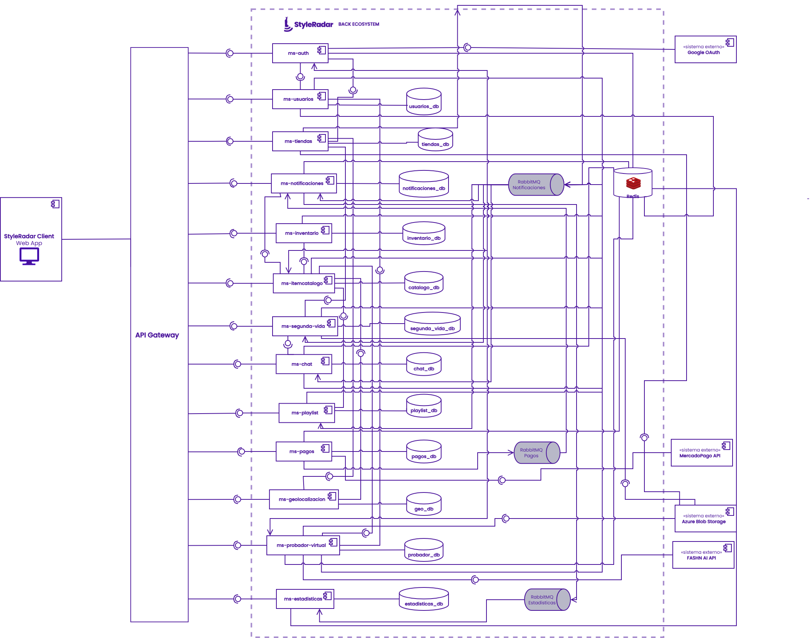
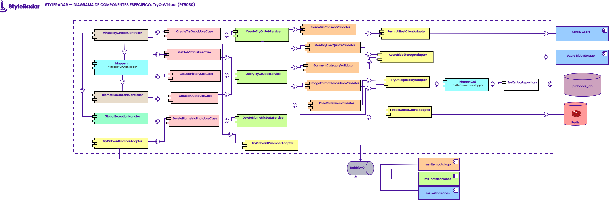
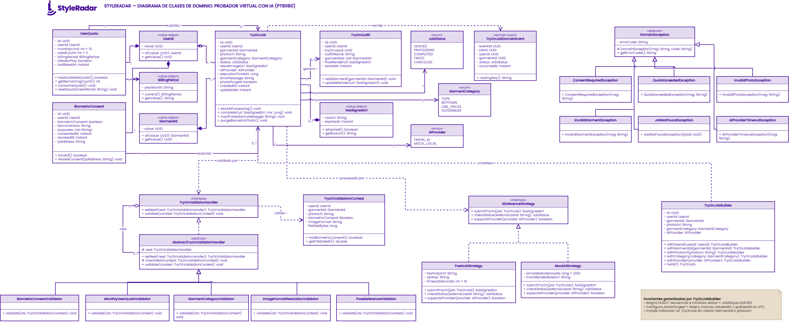
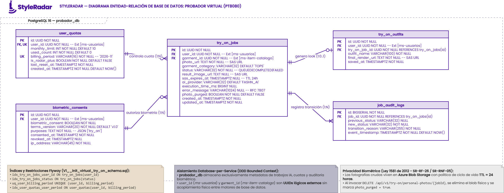
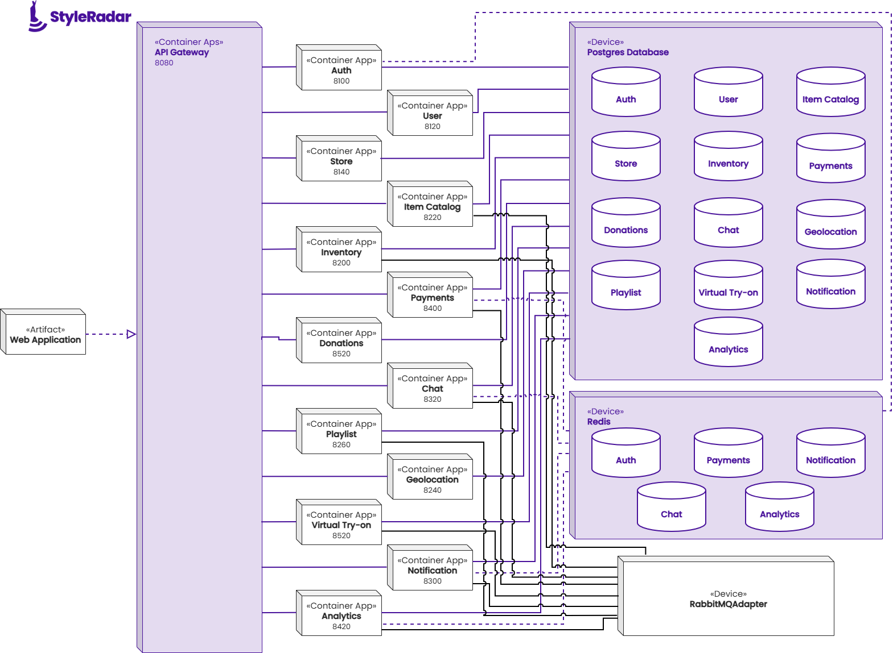

[⬅ Volver al README Principal](../../README.md)

---

## 2. ARQUITECTURA HEXAGONAL CON SUS DIAGRAMAS

El microservicio implementa estrictamente **Arquitectura Hexagonal (Puertos y Adaptadores)** combinada con principios de **Domain-Driven Design (DDD)**. El núcleo de negocio permanece 100% puro en Java, desacoplado de frameworks web, motores de persistencia o brokers de mensajería.

### Diagramas del Microservicio

#### 2.1 Diagrama de Componentes General (Ecosistema StyleRadar)

<div align="center">
  
</div>

Este diagrama ubica a nuestro microservicio (`ms-probador-virtual`) dentro de la arquitectura global del backend de StyleRadar:

* **Puerta de Entrada Perimetral (API Gateway):** Todas las solicitudes originadas desde el cliente (`StyleRadar Client Web App`) ingresan a través del **API Gateway**. El Gateway actúa como proxy inverso y fachada perimetral única, centralizando el enrutamiento hacia los servicios internos y evitando la exposición pública directa de la red interna de microservicios.
* **Ecosistema de 13 Microservicios:** La plataforma distribuye sus dominios de negocio en 13 microservicios independientes (`ms-auth`, `ms-usuarios`, `ms-tiendas`, `ms-notificaciones`, `ms-inventario`, `ms-itemcatalogo`, `ms-segunda-vida`, `ms-chat`, `ms-playlist`, `ms-pagos`, `ms-geolocalizacion`, `ms-probador-virtual` y `ms-estadisticas`). Dentro de este ecosistema, nuestro servicio `ms-probador-virtual` encapsula exclusivamente la orquestación asíncrona de pruebas virtuales con inteligencia artificial, validación de consentimientos biométricos y control de cuotas de uso.
* **Aislamiento de Persistencia (*Database-per-Service*):** Cada microservicio administra su propio esquema de base de datos relacional PostgreSQL de forma 100% aislada (`probador_db` en nuestro caso, junto a `usuarios_db`, `tiendas_db`, `notificaciones_db`, `inventario_db`, `catalogo_db`, `segunda_vida_db`, `chat_db`, `playlist_db`, `pagos_db`, `geo_db` y `estadisticas_db`). Ningún microservicio realiza consultas directas a tablas de otros dominios, eliminando acoplamientos a nivel de base de datos.
* **Capa de Aceleración con Redis:** Un cluster de Redis proporciona almacenamiento volátil en memoria para operaciones de lectura ultrarrápida. Es aprovechado principalmente por `ms-auth` para sesiones/tokens y por `ms-probador-virtual` para consultar cuotas en milisegundos y gestionar bloqueos de concurrencia e idempotencia.
* **Comunicación Asíncrona Orientada a Eventos (RabbitMQ):** La mensajería desacopla operaciones de alta latencia o múltiples suscriptores mediante brokers y colas dedicadas (`RabbitMQ Notificaciones`, `RabbitMQ Pagos`, `RabbitMQ Estadisticas`). Cuando una prueba virtual finaliza o cambia de estado, `ms-probador-virtual` emite eventos de dominio para que los servicios de notificaciones, analítica o catálogo los procesen en background sin bloquear la respuesta HTTP al usuario.
* **Frontera con Proveedores SaaS Externos:** En el lateral derecho se delimitan claramente los servicios externos fuera del perímetro de StyleRadar: **Google OAuth** (autenticación federada en `ms-auth`), **MercadoPago API** (procesamiento de transacciones en `ms-pagos`), **Azure Blob Storage** (almacenamiento de fotos en catálogo y siluetas/renders en `ms-probador-virtual`), y la **API de FASHN AI** (motor neuronal generativo para la inferencia de prueba de prendas).

#### 2.2 Diagrama de Componentes Específico (Arquitectura Hexagonal PT8080)

<div align="center">
  
</div>

Aquí entramos en el detalle interno de nuestro microservicio (`PT8080-VirtualTryOn-Service`), diseñado bajo **Arquitectura Hexagonal (Puertos y Adaptadores)** y principios de Domain-Driven Design (DDD). El flujo se lee de izquierda a derecha:

* **Adaptadores de Entrada (`infrastructure.adapter.in`):** Las peticiones dirigidas al puerto `8500` son recibidas por controladores REST dedicados: `VirtualTryOnRestController` (procesamiento y consulta de jobs en `/api/v1/try-on/jobs`) y `BiometricConsentController` (gestión de consentimientos y fotos de silueta bajo Ley 1581). `TryOnEventListenerAdapter` procesa eventos AMQP entrantes de RabbitMQ, mientras que `GlobalExceptionHandler` captura fallos y los traduce al estándar RFC 7807 (Problem Details).
* **Mapeo y Puertos de Entrada (`application.port.in`):** El mapper de entrada `VirtualTryOnDtoMapper` (`MapperIn`) transforma los DTOs de transporte en objetos y comandos de dominio puro. Estos invocan los puertos de entrada (`CreateTryOnJobUseCase`, `GetJobStatusUseCase`, `GetJobHistoryUseCase`, `GetUserQuotaUseCase` y `DeleteBiometricPhotoUseCase`), los cuales son coordinados por los servicios de aplicación (`CreateTryOnJobService`, `QueryTryOnJobsService` y `DeleteBiometricDataService`).
* **Cadenas de Validación de Dominio (Chain of Responsibility):** La arquitectura separa limpiamente dos flujos de validación secuenciales para no acoplar la subida del archivo físico con la solicitud de renderizado:
  1. **Cadena de Creación de Prueba Virtual (`CreateTryOnJobService`):** Ejecuta una cadena de **3 validadores** antes de encolar el trabajo:
     - `BiometricConsentValidator` (Regla V01): Comprueba que el usuario disponga de consentimiento activo y vigente (Ley 1581 Habeas Data).
     - `MonthlyUserQuotaValidator` (Regla V02): Valida que el usuario tenga saldo en su cuota mensual según su plan (Free vs. Radar+).
     - `GarmentCategoryValidator` (Regla V03): Verifica que la prenda pertenezca a una categoría compatible (`TOPS`, `BOTTOMS`, `ONE_PIECES`).
     Si cualquiera de estas tres reglas se incumple, la cadena interrumpe el flujo de forma temprana y evita consumir créditos innecesarios en la IA generativa.
  2. **Cadena de Gestión y Registro de Fotografía Biométrica (`BiometricConsentService` / SR-RF-23):** Desacoplada en el endpoint de carga de silueta para validar la calidad del archivo antes de subirlo al Blob Storage:
     - `BiometricConsentValidator`: Valida la preexistencia del consentimiento.
     - `ImageFormatResolutionValidator` (Regla V04): Controla estrictamente los formatos admitidos (**únicamente JPEG o PNG**, rechazando WebP), peso máximo de **hasta 5 MB** (no 10 MB), *magic bytes* y resolución mínima de 300x400 píxeles.
     - `PoseReferenceValidator` (Regla V05): Revisa la pose corporal frontal adecuada para el renderizado.
* **Adaptadores de Salida (`infrastructure.adapter.out`):** Los puertos de salida aíslan al dominio de la infraestructura tecnológica:
  - `FashnAiRestClientAdapter`: Cliente HTTP síncrono basado en Spring `RestClient` (protegido con Resilience4j Circuit Breaker y timeouts acotados) que delega la inferencia a la API externa de FASHN AI.
  - `AzureBlobStorageAdapter`: Gestiona el guardado seguro de siluetas en Azure Blob Storage y la generación dinámica de URLs firmadas SAS temporales de corta duración al consultar recursos.
  - `RedisQuotaCacheAdapter`: Consulta y actualiza los contadores de cuota en Redis 7.2 en milisegundos.
  - `TryOnRepositoryAdapter`: Persiste el estado de los jobs y auditorías en PostgreSQL 16 mediante `TryOnPersistenceMapper` (`MapperOut`) y `TryOnJpaRepository`.
* **Publicación de Eventos Asíncronos:** En la parte inferior, `TryOnEventPublisherAdapter` envía los eventos de dominio (`TryOnJobCreatedEvent` / `TryOnJobCompletedEvent`) al broker RabbitMQ 3.13 (`q.tryon.* + DLQ`), permitiendo que `Catalog & Stores Service`, `Notifications & Email Service` y `Audit & Analytics Service` reaccionen de forma asíncrona sin acoplamiento temporal ni llamadas síncronas bloqueantes.

#### 2.3 Diagrama de Clases del Modelo de Dominio

<div align="center">
  
</div>

Este diagrama presenta el modelo de dominio en Java puro (sin dependencias de frameworks ni infraestructura), siguiendo convenciones de identificadores técnicos en inglés y notas explicativas en español:

* **Agregado Raíz `TryOnJob`:** Representa una orden de prueba virtual. Controla su ciclo de vida estricto mediante la enumeración `JobStatus` (`QUEUED` -> `PROCESSING` -> `COMPLETED` / `FAILED` / `CANCELLED`) a través de métodos de negocio explícitos como `startAiProcessing()`, `complete()`, `markFailed()` y `purgeBiometricPhoto()`.
* **Entidades de Soporte y Value Objects:**
  - `UserQuota`: Modela el límite mensual (`monthlyLimit`), el conteo consumido (`usedCount`) y el estado de suscripción Radar+.
  - `BiometricConsent`: Custodia la autorización legal de tratamiento de datos biométricos con su versión de términos, lista de propósitos y fecha de revocación.
  - `TryOnOutfit`: Asocia un job completado con las prendas probadas y la URL canónica permanente del renderizado (firmada dinámicamente con `SasSignedUrl` de corta duración al ser consultada).
  - *Value Objects inmutables:* `UserId`, `GarmentId`, `BillingPeriod` y `SasSignedUrl` (utilizado para validar y encapsular URLs firmadas de lectura temporales expuestas a los clientes), que encapsulan validaciones y evitan el paso de tipos primitivos o cadenas desnudas.
* **Jerarquía de Excepciones de Dominio:** Todas las excepciones de negocio (`ConsentRequiredException`, `QuotaExceededException`, `InvalidPhotoException`, `InvalidGarmentException`, `JobNotFoundException`, `AiProviderTimeoutException`) extienden de `DomainException`, portando códigos de error semánticos legibles para ser mapeados directamente al estándar RFC 7807 por el controlador de excepciones.
* **Patrones de Diseño Implementados:**
  - **Chain of Responsibility:** La interfaz `TryOnValidatorHandler` y la clase abstracta `AbstractTryOnValidatorHandler` estructuran las validaciones en dos cadenas desacopladas: la cadena de creación de jobs (`BiometricConsentValidator`, `MonthlyUserQuotaValidator` y `GarmentCategoryValidator`) y la cadena de ingesta de fotografía biométrica (`BiometricConsentValidator`, `ImageFormatResolutionValidator` y `PoseReferenceValidator`) sobre `TryOnValidationContext`. Esto permite añadir o modificar reglas de negocio sin alterar el flujo de los demás validadores.
  - **Strategy:** `AiInferenceStrategy` desacopla el motor de inferencia con dos implementaciones intercambiables: `FashnAiStrategy` (integración productiva con la API externa) y `MockAiStrategy` (simulación local para pruebas automatizadas y CI/CD sin consumo de créditos reales).
  - **Builder:** `TryOnJobBuilder` asegura la construcción válida del agregado `TryOnJob`, verificando que se inicialice con estado `QUEUED`, sin foto purgada y con fechas en UTC consistentes.

#### 2.4 Diagrama de Base de Datos (`probador_db` · PostgreSQL 16, Redis 7.2 y Azure Blob Storage)

<div align="center">
  
</div>

Representa el diseño físico de persistencia de nuestro microservicio, cumpliendo el principio *Database-per-Service* con tablas y columnas en formato `snake_case`:

* **PostgreSQL 16 (`probador_db`):**
  - `try_on_jobs`: Tabla principal que registra cada prueba virtual con su estado (`status`), proveedor de IA (`ai_provider`), duración en milisegundos (`execution_time_ms`), URLs canónicas permanentes (`photo_url`, `result_image_url`, almacenadas limpias y sin parámetros ni credenciales SAS tras las migraciones V6/V7) y bandera de eliminación (`photo_purged`). No almacena tokens ni expiración SAS en base de datos. Los campos `user_id` y `garment_id` son llaves foráneas lógicas (UUID) que preservan el desacoplamiento con `ms-usuarios` y `ms-item-catalogo` sin dependencias físicas de base de datos.
  - `user_quotas`: Lleva el control de consumo mensual por usuario con restricción de unicidad compuesta `UNIQUE (user_id, billing_period)`.
  - `biometric_consents`: Almacena la trazabilidad de consentimiento legal exigida por la Ley 1581 (versión de términos, finalidades en JSON, dirección IP y estampas de tiempo de otorgamiento o revocación).
  - `try_on_outfits`: Vincula looks guardados con prendas asociadas y la URL canónica permanente del resultado generado (`final_render_url`, sin parámetros SAS en base de datos tras la migración V7).
  - `job_audit_logs`: Bitácora inmutable de transiciones de estado (`previous_status` a `new_status` con motivo), crucial para trazabilidad y depuración de incidentes.
* **Redis 7.2 (`probador-redis`):** Caché en memoria para consulta ultrarrápida del estado de cuotas de usuario, semáforo de jobs concurrentes y claves de idempotencia, evitando saturar la base relacional con lecturas redundantes en picos de tráfico.
* **Azure Blob Storage:** Almacén seguro de objetos binarios organizado en contenedores privados (`biometric-silhouettes` y `tryon-renders`). La base de datos relacional nunca almacena binarios de imágenes ni credenciales SAS: las migraciones `V6` y `V7` eliminan estrictamente cualquier parámetro query de las URLs guardadas en PostgreSQL (`photo_url`, `result_image_url`, `final_render_url`), persistiendo exclusivamente la ruta canónica limpia del blob. Cuando el cliente consulta un recurso, el servicio genera dinámicamente un token Service SAS de solo lectura (`sp=r`) con firma criptográfica HMAC-SHA256 y una duración máxima estrictamente limitada a **15 minutos** (`PT15M`, no 24 horas), garantizando el cumplimiento de la Ley 1581 y minimizando la exposición de datos biométricos.

#### 2.5 Diagrama de Despliegue General (Infraestructura de Contenedores y Servicios)

<div align="center">
  
</div>

Este diagrama describe la topología física y de despliegue de toda la solución StyleRadar, mostrando cómo se distribuyen los componentes en contenedores y dispositivos dedicados de base de datos, caché y mensajería:

* **Cliente y Enrutamiento Perimetral:**
  - El cliente web (`«Artifact» Web Application`) se conecta al sistema a través del contenedor perimetral **`«Container App» API Gateway`**, que escucha en el puerto público estándar `8080`.
  - El Gateway se encarga de la recepción del tráfico HTTP, la terminación TLS y el enrutamiento interno hacia la red privada donde residen los microservicios.
* **Malla de Contenedores de Microservicios (`«Container App»`):**
  Los 13 microservicios se despliegan como contenedores independientes, cada uno asignado a un puerto específico para evitar colisiones:
  - `Auth` (:8100) — Autenticación, registro y seguridad federada.
  - `User` (:8120) — Gestión de perfiles y roles de usuario.
  - `Store` (:8140) — Administración de tiendas y comercios de moda.
  - `Item Catalog` (:8220) — Catálogo de prendas, tallas y categorías.
  - `Inventory` (:8200) — Control de existencias e inventario en tiempo real.
  - `Payments` (:8400) — Integración con pasarelas de pago y planes de suscripción.
  - `Donations` (:8520) — Módulo de economía circular y donaciones (`ms-segunda-vida`).
  - `Chat` (:8320) — Comunicación interactiva y mensajería en la plataforma.
  - `Playlist` (:8260) — Listas y recomendaciones personalizadas de outfits.
  - `Geolocation` (:8240) — Búsqueda geográfica y cercanía de tiendas.
  - `Virtual Try-on` (:8500) — Nuestro microservicio, desplegado en un contenedor dedicado para aislar el consumo computacional de la orquestación de IA y proteger la disponibilidad global del sistema.
  - `Notification` (:8300) — Servicio de despacho de notificaciones y correos.
  - `Analytics` (:8420) — Telemetría, analítica de uso y métricas de plataforma.
* **Dispositivo de Bases de Datos Relacionales (`«Device» Postgres Database`):**
  Un servidor dedicado de PostgreSQL hospeda 13 bases de datos lógicamente independientes (`Auth`, `User`, `Item Catalog`, `Store`, `Inventory`, `Payments`, `Donations`, `Chat`, `Geolocation`, `Playlist`, `Virtual Try-on` correspondiente a `probador_db`, `Notification`, `Analytics`). Esta arquitectura garantiza aislamiento total de transacciones y mantenimiento individual por esquema sin riesgo de impacto cruzado.
* **Dispositivo de Caché Distribuida (`«Device» Redis`):**
  Un servidor de Redis centraliza el almacenamiento volátil de alta frecuencia para los servicios con mayor demanda de concurrencia y velocidad de respuesta (`Auth`, `Payments`, `Notification`, `Chat`, `Analytics`, y las operaciones de cuotas y bloqueos concurrentes de `Virtual Try-on`).
* **Dispositivo Broker de Mensajería (`«Device» RabbitMQAdapter`):**
  Gestiona la infraestructura de colas y exchanges para la comunicación asíncrona entre contenedores. Permite que tareas de larga duración (como el procesamiento de imágenes o confirmaciones transaccionales) se desacoplen de las peticiones HTTP directas, aumentando la resiliencia y tolerancia a fallos del sistema global.

### Estructura Oficial de Paquetes en `src/main/java/edu/dosw/styleradar/virtualtryon/`

```text
src/main/java/edu/dosw/styleradar/virtualtryon/
├── VirtualTryOnApplication.java                     <-- Punto de entrada Spring Boot
├── domain/                                          <-- NÚCLEO DE DOMINIO (Java Puro, cero dependencias)
│   ├── model/                                       <-- Entidades y Agregados raíz (TryOnJob, UserQuota, BiometricConsent, TryOnOutfit)
│   ├── valueobject/                                 <-- Value Objects inmutables (UserId, GarmentId, BillingPeriod, SasSignedUrl)
│   ├── port/
│   │   ├── in/                                      <-- Puertos de entrada de dominio (CreateTryOnJobUseCase, GetJobStatusUseCase, etc.)
│   │   └── out/                                     <-- Puertos de salida de dominio
│   ├── exception/                                   <-- Excepciones de negocio (ConsentRequiredException, QuotaExceededException, etc.)
│   └── event/                                       <-- Eventos de dominio puros (TryOnJobDomainEvent)
├── application/                                     <-- CAPA DE APLICACIÓN (Orquestación de Casos de Uso)
│   ├── port/
│   │   ├── in/                                      <-- Input Ports (Casos de uso consumidos por adaptadores)
│   │   └── out/                                     <-- Output Ports (Contratos para repositorios, broker, IA)
│   ├── usecase/                                     <-- Implementación de casos de uso
│   ├── service/                                     <-- Servicios de aplicación (CreateTryOnJobService, QueryTryOnJobsService, DeleteBiometricDataService)
│   └── dto/                                         <-- Data Transfer Objects (Java Records inmutables)
│       ├── request/                                 <-- StartTryOnRequest
│       └── response/                                <-- TryOnJobResponse, UserQuotaResponse
└── infrastructure/                                  <-- CAPA DE INFRAESTRUCTURA (Detalles tecnológicos)
    ├── adapter/
    │   ├── in/
    │   │   ├── rest/                                <-- Controladores Spring REST (VirtualTryOnRestController)
    │   │   │   └── doc/                             <-- Contratos OpenAPI / Swagger (VirtualTryOnOpenApiDoc)
    │   │   └── event/                               <-- Consumidores AMQP RabbitMQ (TryOnEventListenerAdapter)
    │   └── out/
    │       ├── persistence/                         <-- Adaptadores Spring Data JPA (TryOnRepositoryAdapter, TryOnPersistenceMapper, TryOnJpaRepository)
    │       ├── client/                              <-- Clientes Spring RestClient hacia motor externo FASHN AI (FashnAiRestClientAdapter)
    │       └── event/                               <-- Productores de eventos RabbitMQ (TryOnEventPublisherAdapter)
    ├── config/                                      <-- Beans de configuración (OpenApiConfig, RabbitConfig, RedisConfig)
    └── exception/                                   <-- Manejo global de excepciones RFC 7807 (GlobalExceptionHandler)
```

---

[⬅ Volver al README Principal](../../README.md)
