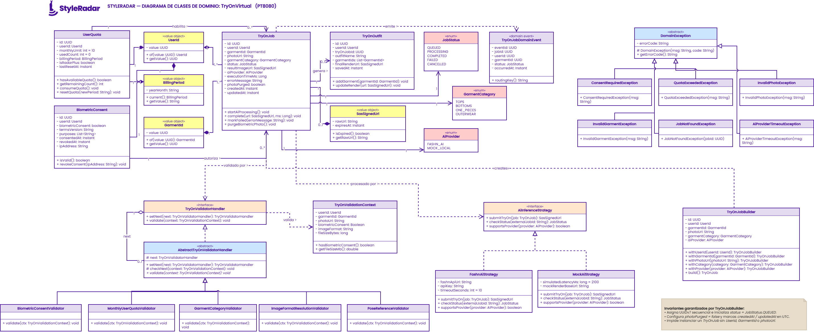
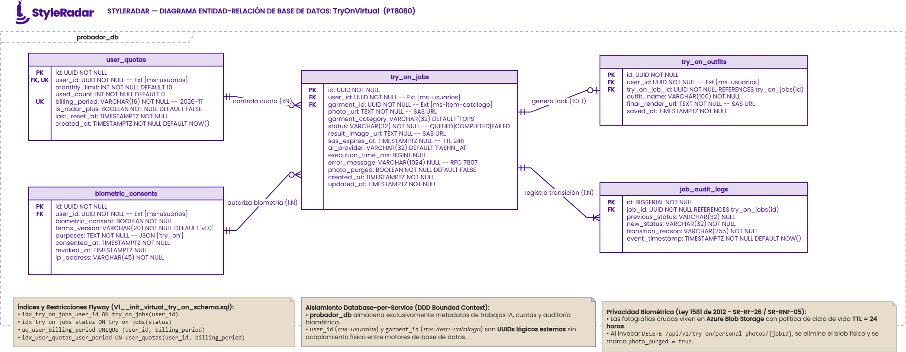
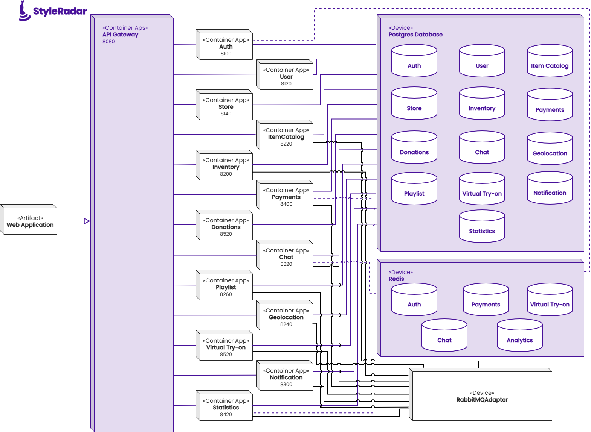
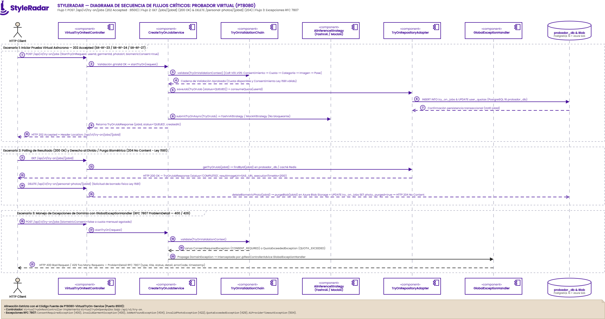

[⬅ Volver al README Principal](../../README.md)

---

## 2. ARQUITECTURA HEXAGONAL CON SUS DIAGRAMAS

El microservicio `PT8080-VirtualTryOn-Service` (`ms-probador-virtual`) implementa rigurosamente **Arquitectura Hexagonal (Puertos y Adaptadores)** en conjunto con principios de **Domain-Driven Design (DDD)**. El núcleo de negocio permanece 100% puro en Java, completamente desacoplado de dependencias tecnológicas, frameworks web, motores de persistencia o brokers de mensajería.

---

### Diagramas del Microservicio

---

#### 2.1 Diagrama de Componentes General (Ecosistema StyleRadar)

<div align="center">
  
</div>

##### Justificación y Explicación Técnica de la Arquitectura del Ecosistema

Este diagrama modela la vista general de la arquitectura del backend de **StyleRadar**, posicionando a nuestro microservicio (`ms-VirtualTryOn`) dentro de la red global de 13 microservicios y delimitando con precisión las fronteras de comunicación:

* **Puerta de Entrada Perimetral (API Gateway):**
  * Todas las solicitudes originadas desde la aplicación cliente (`StyleRadar Client Web App`) ingresan a través del **API Gateway** perimetral (puerto `8080`).
  * El Gateway actúa como proxy inverso y fachada perimetral única, centralizando la terminación TLS, el enrutamiento inteligente hacia la red privada de microservicios y la inyección de cabeceras de contexto (`X-User-Id`), aislando por completo la red interna de accesos no autorizados.

* **Ecosistema de 13 Microservicios Autónomos:**
  * La plataforma distribuye sus dominios de negocio en 13 servicios independientes bajo nomenclatura unificada:
    - **Paquete 1 (Identidad):** `ms-Auth` (:8100), `ms-Users` (:8120) y `ms-Stores` (:8140).
    - **Paquete 2 (Catálogo):** `ms-Inventory` (:8200), `ms-ItemCatalog` (:8220), `ms-Playlist` (:8260) y `ms-Geolocation` (:8240).
    - **Paquete 3 (Mensajería y Notificaciones):** `ms-Notifications` (:8300) y `ms-Chat` (:8320).
    - **Paquete 4 (Financiero y Analítica):** `ms-Payment` (:8400) y `ms-Statistics` (:8420).
    - **Paquete 5 (Experiencia y Moda Sostenible):** `ms-VirtualTryOn` (:8500) y `ms-Donations` (:8520).
  * Dentro de esta malla, nuestro servicio `ms-VirtualTryOn` encapsula de forma exclusiva la orquestación asíncrona de pruebas virtuales con inteligencia artificial generativa, el control de cuotas mensuales de uso y la custodia legal de consentimientos biométricos bajo la Ley 1581 de Habeas Data.

* **Ensambles Síncronos Ball-and-Socket (`---) (O---`) de `ms-VirtualTryOn`:**
  Siguiendo el estándar UML 2.5, la comunicación HTTP REST directa se modela mediante interfaces requeridas (*Sockets* `--)`) e interfaces provistas (*Balls / Piruletas* `(O`):
  1. **Recepción desde Gateway (`API Gateway ---) (O--- ms-VirtualTryOn`):** Nuestro servicio expone su interfaz provista `(O` en el puerto `8500` para recibir las solicitudes de prueba virtual (`/api/v1/try-on/**`).
  2. **Consumo hacia `ms-Users` (`ms-VirtualTryOn ---) (O--- ms-Users`):** Consume mediante socket la interfaz de usuarios para obtener medidas corporales (estatura, busto, cintura, cadera) y validar la compatibilidad física de la silueta previa al renderizado (`SR-RF-24`).
  3. **Consumo hacia `ms-ItemCatalog` (`ms-VirtualTryOn ---) (O--- ms-ItemCatalog`):** Consume mediante socket la interfaz de catálogo para obtener las especificaciones técnicas de corte y la fotografía frontal de la prenda en alta resolución (`SR-RF-24`).
  4. **Consumo hacia `ms-Payment` (`ms-VirtualTryOn ---) (O--- ms-Payment`):** Consume mediante socket la interfaz de suscripciones para verificar el plan activo del usuario (`FREE` con cuota básica vs. `RADAR_PLUS` con cuota ampliada) antes de autorizar el trabajo (`P5-N02`).

* **Aislamiento Estricto de Persistencia (*Database-per-Service*):**
  * Cada microservicio administra su propio esquema de base de datos PostgreSQL de forma 100% aislada en 12 bases relacionales (`virtual_try_on_db`, `users_db`, `stores_db`, `notifications_db`, `inventory_db`, `catalog_db`, `donations_db`, `chat_db`, `playlist_db`, `payments_db`, `geo_db` y `statistics_db`; `ms-Auth` no requiere base relacional).
  * No existen consultas cruzadas ni llaves foráneas físicas inter-servicio; las referencias se mantienen mediante identificadores lógicos inmutables (UUID), garantizando alta disponibilidad y escalabilidad horizontal independiente.

* **Capa de Aceleración en Memoria con Redis:**
  * Un clúster de **Redis** proporciona almacenamiento volátil de lectura ultrarrápida en memoria (< 3 ms) organizado en 5 particiones lógicas (`Auth`, `Payment`, `Chat`, `Statistics` y `Virtual Try-on`).
  * `ms-VirtualTryOn` consume la partición `Virtual Try-on` para consultar cuotas de usuario en milisegundos y evitar saturar la base relacional con lecturas concurrentes redundantes.

* **Comunicación Asíncrona Orientada a Eventos (RabbitMQ):**
  * La mensajería asíncrona desacopla flujos de alta latencia o dependencias multidireccionales mediante brokers y colas dedicadas (`RabbitMQ Usuarios`, `RabbitMQ Notificaciones`, `RabbitMQ ItemCatalogo`, `RabbitMQ Pagos`, `RabbitMQ Geolocalizacion`, `RabbitMQ Estadisticas`).
  * Cuando un usuario elimina su cuenta, `ms-VirtualTryOn` consume el evento para purgar automáticamente y de forma irreversible cualquier dato biométrico; a su vez, al completarse una prueba o purgarse una imagen, publica eventos para notificaciones y auditoría analítica sin bloquear el hilo HTTP de respuesta al cliente.

* **Frontera Perimetral con Proveedores SaaS Externos:**
  * En el lateral derecho se delimitan claramente los servicios externos fuera del perímetro de StyleRadar:
    * **Google OAuth:** Autenticación federada hacia `ms-Auth`.
    * **MercadoPago API:** Pasarela transaccional de pagos hacia `ms-Payment`.
    * **Azure Blob Storage:** Almacén seguro de objetos binarios en la nube para fotos de tiendas y prendas (`ms-Stores`), prendas donadas (`ms-Donations`) y siluetas/renders biométricos efímeros (`ms-VirtualTryOn`).
    * **FASHN AI API:** Motor neuronal generativo en la nube que procesa la inferencia del modelo Virtual Try-On en GPUs especializadas consumido exclusivamente por `ms-VirtualTryOn`.

---

#### 2.2 Diagrama de Componentes Específico (Arquitectura Hexagonal PT8080)

<div align="center">
  
</div>

##### Justificación y Explicación Técnica de la Arquitectura Interna

Este diagrama detalla la anatomía interna de `PT8080-VirtualTryOn-Service`, diseñado bajo **Arquitectura Hexagonal (Puertos y Adaptadores)** y principios de Domain-Driven Design (DDD). El flujo operativo se lee limpiamente de izquierda a derecha:

* **Adaptadores de Entrada (`infrastructure.adapter.in`):**
  * **`VirtualTryOnRestController`:** Atiende el tráfico REST sobre el puerto `8500` en la ruta `/api/v1/try-on/jobs`. Gestiona la creación de órdenes de prueba asíncronas (`202 Accepted` + `jobId`), la consulta de estado mediante polling (`200 OK`) y el historial de pruebas.
  * **`BiometricConsentController`:** Expone los endpoints de carga de siluetas de usuario y consentimiento informado bajo la Ley 1581 (`POST /api/v1/try-on/photos`), así como la solicitud de derecho al olvido y purga física de fotos (`DELETE /api/v1/try-on/personal-photos/{jobId}`).
  * **`TryOnEventListenerAdapter`:** Adaptador AMQP que escucha eventos asíncronos provenientes de RabbitMQ (como la eliminación de cuenta de un usuario para ejecutar la purga obligatoria de datos sensibles).
  * **`GlobalExceptionHandler`:** Intercepta todas las excepciones del dominio y de infraestructura (`@RestControllerAdvice`), traduciéndolas a cargas útiles estandarizadas bajo el estándar **RFC 7807 (Problem Details)**.
  * **`MapperIn` (`VirtualTryOnDtoMapper`):** Transforma de manera bidireccional los DTOs de transporte HTTP en comandos y modelos puros del dominio, aislando a la capa de aplicación de contratos externos.

* **Puertos de Entrada de Aplicación (`application.port.in`):**
  * Definen los contratos funcionales de negocio expuestos hacia los adaptadores: `CreateTryOnJobUseCase`, `GetJobStatusUseCase`, `GetJobHistoryUseCase`, `GetUserQuotaUseCase` y `DeleteBiometricPhotoUseCase`.

* **Servicios de Aplicación (`application.service`):**
  * **`CreateTryOnJobService`:** Orquesta la validación de negocio, reserva de saldo de cuota, persistencia inicial en estado `QUEUED` y despacho asíncrono hacia el motor de inteligencia artificial.
  * **`QueryTryOnJobsService`:** Gestiona las consultas de estado, historial y cuotas de usuario, coordinando la generación dinámica de URLs firmadas temporales.
  * **`DeleteBiometricDataService`:** Ejecuta la eliminación física de blobs biométricos en Azure Storage y la actualización inmutable de la bandera `photo_purged = true` en base de datos.

* **Cadena de Validación de Dominio (*Chain of Responsibility*):**
  Para asegurar máxima cohesión y desacoplamiento, la lógica de validación se divide en eslabones modulares e independientes que evalúan el contexto antes de ejecutar operaciones costosas:
  1. **`BiometricConsentValidator` (Regla V01):** Comprueba que el usuario disponga de autorización explícita de tratamiento biométrico activa y no revocada (Ley 1581 de Habeas Data).
  2. **`MonthlyUserQuotaValidator` (Regla V02):** Verifica que el usuario cuente con saldo de pruebas disponible en su cuota del período mensual vigente (Free vs. Radar+).
  3. **`GarmentCategoryValidator` (Regla V03):** Valida que la prenda solicitada pertenezca a una categoría compatible para prueba virtual (`TOPS`, `BOTTOMS`, `ONE_PIECES`, `OUTERWEAR`).
  4. **`ImageFormatResolutionValidator` (Regla V04):** Controla estrictamente los formatos admitidos mediante *magic bytes* reales (**únicamente JPEG o PNG**, rechazando WebP), peso máximo de **hasta 5 MB** y resolución mínima de $300\times 400$ píxeles.
  5. **`PoseReferenceValidator` (Regla V05):** Valida la postura corporal frontal y la iluminación adecuada para garantizar una inferencia exitosa en el modelo de visión artificial.

* **Adaptadores de Salida (`infrastructure.adapter.out`):**
  Aíslan al núcleo de negocio de la infraestructura tecnológica mediante puertos de salida:
  * **`FashnAiRestClientAdapter`:** Cliente HTTP basado en Spring `RestClient` (protegido con Resilience4j Circuit Breaker y timeouts acotados) que se conecta con la API externa de **FASHN AI** para ejecutar la inferencia del modelo en GPU.
  * **`AzureBlobStorageAdapter`:** Gestiona el almacenamiento binario seguro en Azure Blob Storage y genera dinámicamente firmas criptográficas **SAS (*Shared Access Signature*) de solo lectura con vigencia máxima de 15 minutos** (`PT15M`).
  * **`TryOnRepositoryAdapter`:** Implementa la persistencia mediante `MapperOut` (`TryOnPersistenceMapper`) y `TryOnJpaRepository` sobre PostgreSQL 16 (`probador_db`).
  * **`RedisQuotaCacheAdapter`:** Consulta y actualiza los contadores de cuota mensual y claves de concurrencia en Redis 7.2 en milisegundos.
  * **`TryOnEventPublisherAdapter`:** Publica eventos de dominio (`TryOnJobCreatedEvent`, `TryOnJobCompletedEvent`, `tryon.photo.purged`) hacia el broker **RabbitMQ 3.13**, permitiendo que `ms-itemcatalogo`, `ms-notificaciones` y `ms-estadisticas` sincronicen su estado de forma asíncrona.

---

#### 2.3 Diagrama de Clases del Modelo de Dominio

<div align="center">
  
</div>

##### Justificación y Explicación Técnica del Modelo de Dominio

Este diagrama modela el núcleo de dominio puro en Java (sin anotaciones de Spring, JPA ni dependencias de frameworks externos), aplicando conceptos avanzados de **Domain-Driven Design (DDD)** y patrones de diseño orientados a objetos:

* **Agregado Raíz `TryOnJob`:**
  * Modela la entidad principal de negocio que representa una solicitud de prueba virtual.
  * Protege sus invariantes internas encapsulando su ciclo de vida a través de métodos de mutación semánticos:
    * `startAiProcessing()`: Transiciona el estado a `PROCESSING` y registra la marca de tiempo de inicio.
    * `complete(resultImageUrl, executionTimeMs)`: Asigna la URL del resultado y culmina en estado `COMPLETED`.
    * `markFailed(errorMessage)`: Captura el motivo de fallo y transiciona a estado `FAILED`.
    * `purgeBiometricPhoto()`: Marca la bandera `photoPurged = true` y desasocia las rutas de imagen tras el derecho al olvido.
  * Utiliza identificadores técnicos consistentes y tipos de dominio fuertemente tipados.

* **Entidades de Soporte del Dominio:**
  * **`UserQuota`:** Controla el consumo mensual de pruebas (`monthlyLimit`, `usedCount`). Contiene la lógica de negocio para validar disponibilidad (`hasAvailableQuota()`), calcular remanentes (`getRemainingCount()`), consumir saldo (`consumeQuota()`) y renovar períodos (`resetQuota()`).
  * **`BiometricConsent`:** Custodia la validez jurídica de la autorización de datos biométricos (`biometricConsent`, `termsVersion`, `purposes`, `consentedAt`, `revokedAt`, `ipAddress`), ofreciendo métodos como `isValid()` y `revokeConsent()`.
  * **`TryOnOutfit`:** Asocia un trabajo completado exitosamente con las prendas probadas y la URL canónica del renderizado generado, permitiendo la adición de prendas (`addGarment()`) y actualización del render (`updateRender()`).

* **Value Objects Inmutables:**
  * **`UserId` / `GarmentId`:** Encapsulan los identificadores universales únicos (UUID) de usuarios y prendas, previniendo el paso de tipos primitivos o cadenas desnudas (*Primitive Obsession*).
  * **`BillingPeriod`:** Modela el ciclo mensual de facturación (formato `YYYY-MM`), con métodos de fábrica como `current()` y validación temporal estricta.
  * **`SasSignedUrl`:** Encapsula la URL firmada temporal de acceso al almacenamiento en la nube, controlando su expiración criptográfica mediante `isExpired()` y garantizando que ningún token vencido sea expuesto a clientes.

* **Enumeraciones de Dominio:**
  * **`JobStatus`:** `QUEUED`, `PROCESSING`, `COMPLETED`, `FAILED`, `CANCELLED`.
  * **`GarmentCategory`:** `TOPS`, `BOTTOMS`, `ONE_PIECES`, `OUTERWEAR`.
  * **`AiProvider`:** `FASHN_AI`, `MOCK_LOCAL`.

* **Eventos de Dominio (`TryOnJobDomainEvent`):**
  * Modela la ocurrencia inmutable de un hecho relevante en el dominio (`eventId`, `jobId`, `userId`, `garmentId`, `status`, `occurredAt`), proporcionando la clave de enrutamiento (`routingKey()`) para su despacho hacia RabbitMQ.

* **Jerarquía de Excepciones Semánticas:**
  * Todas las excepciones de negocio extienden de la clase abstracta `DomainException` (que encapsula el código de error semántico y mensaje descriptivo):
    * `ConsentRequiredException` (Falta consentimiento de datos biométricos).
    * `QuotaExceededException` (Cuota mensual del usuario agotada).
    * `InvalidPhotoException` (Fotografía corrupta, de baja resolución o formato inválido).
    * `InvalidGarmentException` (Prenda incompatible con prueba virtual).
    * `JobNotFoundException` (Identificador de prueba no localizado).
    * `AiProviderTimeoutException` (Excedido el tiempo límite de inferencia en FASHN AI).
  * Esta jerarquía permite un mapeo directo y declarativo hacia códigos HTTP (400, 401, 404, 422, 429, 504) bajo el estándar RFC 7807 en la capa de infraestructura.

* **Patrones de Diseño Implementados:**
  1. **Chain of Responsibility:**
     * La interfaz `TryOnValidatorHandler` y la clase base abstracta `AbstractTryOnValidatorHandler` encadenan los validadores de dominio (`BiometricConsentValidator`, `MonthlyUserQuotaValidator`, `GarmentCategoryValidator`, `ImageFormatResolutionValidator`, `PoseReferenceValidator`) sobre el objeto de contexto `TryOnValidationContext`. Permite añadir, reordenar o desacoplar reglas sin tocar la lógica central.
  2. **Strategy:**
     * La interfaz `AiInferenceStrategy` desacopla la inferencia con dos implementaciones intercambiables: `FashnAiStrategy` (llamada real al proveedor cloud en GPU) y `MockAiStrategy` (simulación local determinista para pruebas automatizadas y pipelines de CI/CD sin consumo de créditos).
  3. **Builder:**
     * `TryOnJobBuilder` garantiza la construcción segura y válida de `TryOnJob`, verificando invariantes obligatorios (asignación de UUID v7, estado inicial `QUEUED`, fechas UTC consistentes y bandera `photoPurged = false`).

---

#### 2.4 Diagrama de Base de Datos (`probador_db` · PostgreSQL 16)

<div align="center">
  
</div>

##### Justificación y Explicación Técnica del Diseño Físico de Persistencia

Este diagrama modela el esquema relacional físico de persistencia en **PostgreSQL 16** (`probador_db`), diseñado bajo el principio de aislamiento **Database-per-Service** con nombres de tablas y columnas normalizados en `snake_case`, alineado al 100% con los scripts de migración Flyway (`V1__init_virtual_try_on_schema.sql` a `V7`):

* **Tablas Relacionales del Microservicio:**
  1. **`user_quotas` (Control de Cuota Mensual):**
     * Almacena el saldo de pruebas virtuales por usuario para cada mes de facturación.
     * Llave primaria `id: UUID`.
     * Restricción de unicidad compuesta `UNIQUE (user_id, billing_period)` que impide duplicidad de registros para un mismo usuario en el mismo ciclo.
     * Atributos: `monthly_limit` (por defecto 10 en básico), `used_count` (contador incremental), `billing_period` (`VARCHAR(16)`, ej. `'2026-11'`), `is_radar_plus` (`BOOLEAN` para usuarios premium), `last_reset_at` y `created_at`.
  2. **`try_on_jobs` (Registro Transaccional de Pruebas Virtuales):**
     * Tabla transaccional central que custodia cada solicitud de prueba virtual.
     * Llave primaria `id: UUID`.
     * Llaves foráneas lógicas `user_id: UUID` (referencia a `ms-usuarios`) y `garment_id: UUID` (referencia a `ms-item-catalogo`), sin acoplamiento físico de motor de base de datos.
     * Atributos de estado y métricas: `garment_category` (`VARCHAR(32)`), `status` (`QUEUED`, `PROCESSING`, `COMPLETED`, `FAILED`), `ai_provider` (`FASHN_AI`), `execution_time_ms` (`BIGINT`), `error_message` (`VARCHAR(1024)` para fallos RFC 7807), `photo_purged` (`BOOLEAN`, bandera de derecho al olvido), `created_at` y `updated_at`.
     * Atributos de almacenamiento: `photo_url` (`TEXT`) y `result_image_url` (`TEXT`), que almacenan exclusivamente la ruta canónica limpia del blob (sin tokens SAS embebidos).
  3. **`biometric_consents` (Custodia Legal de Habeas Data · Ley 1581):**
     * Registra de forma auditable el consentimiento otorgado por el usuario para el procesamiento de sus rasgos biométricos.
     * Atributos: `biometric_consent` (`BOOLEAN`), `terms_version` (`VARCHAR(20)`), `purposes` (`TEXT` con arreglo JSON `['try_on']`), `consented_at` (`TIMESTAMPTZ`), `revoked_at` (`TIMESTAMPTZ NULL`) e `ip_address` (`VARCHAR(45)` para trazabilidad de red).
  4. **`try_on_outfits` (Looks y Outfits Guardados):**
     * Permite a los usuarios guardar combinaciones exitosas de prendas probadas.
     * Llave primaria `id: UUID`, llave foránea lógica `user_id` y llave foránea física local `try_on_job_id: UUID REFERENCES try_on_jobs(id)`.
     * Atributos: `outfit_name` (`VARCHAR(100)`), `final_render_url` (`TEXT`) y `saved_at` (`TIMESTAMPTZ`).
  5. **`job_audit_logs` (Bitácora Inmutable de Auditoría de Estados):**
     * Registra cada cambio de estado por el que atraviesa un trabajo de prueba virtual, fundamental para resolución de incidentes, trazabilidad operativa y soporte.
     * Llave primaria incremental `id: BIGSERIAL`, llave foránea `job_id: UUID REFERENCES try_on_jobs(id)`.
     * Atributos: `previous_status`, `new_status`, `transition_reason` y `event_timestamp`.

* **Cardinalidades del Modelo:**
  * `user_quotas` (1) ── *controla cuota (1:N)* ──> `try_on_jobs`
  * `biometric_consents` (1) ── *autoriza biometría (1:N)* ──> `try_on_jobs`
  * `try_on_jobs` (1) ── *genera look (1:0..1)* ──> `try_on_outfits`
  * `try_on_jobs` (1) ── *registra transición (1:N)* ──> `job_audit_logs`

* **Garantías de Diseño Físico y Cumplimiento Normativo:**
  * **Índices de Rendimiento:** Índices B-Tree optimizados en Flyway: `idx_try_on_jobs_user_id`, `idx_try_on_jobs_status` y `idx_user_quotas_user_period` para consultas de alta velocidad.
  * **Privacidad Biométrica (Ley 1581 de 2012 / SR-RF-26 / SR-RNF-05):** Las imágenes físicas residen en contenedores privados de Azure Blob Storage. Al invocar el endpoint de eliminación `DELETE /api/v1/try-on/personal-photos/{jobId}`, el adaptador destruye el blob físico en Azure y la base de datos actualiza `photo_purged = true`, garantizando el derecho al olvido irreversible sin romper la integridad referencial de auditoría.

---

#### 2.5 Diagrama de Despliegue General (Topología de Infraestructura y Contenedores)

<div align="center">
  
</div>

##### Justificación y Explicación Técnica de la Infraestructura de Despliegue

Este diagrama describe la topología física, el confinamiento de red y la arquitectura de infraestructura en la nube para toda la plataforma **StyleRadar** (Microsoft Azure PaaS / Contenedores OCI):

* **1. Capa de Cliente y Acceso Seguro (`«Device» Client / User Device`):**
  * La aplicación cliente web (`«Artifact» Web Application (React / Vite)`) se ejecuta dentro del navegador del usuario (`«Execution Environment» Web Browser`).
  * Se conecta de forma segura a través de **`HTTPS :443`** (para peticiones REST) y **`WSS :8080`** (WebSockets) hacia el contenedor perimetral **`«Container App» API Gateway :8080`**.
  * El Gateway es el único punto de ingreso con Ingress público expuesto al exterior, centralizando la terminación TLS y enrutando hacia la red privada interna.

* **2. Entorno de Microservicios (`«Execution Environment» Azure Container Apps Environment`):**
  Cada microservicio se ejecuta de manera independiente como una `«Container App»` en una red virtual privada sin exposición pública, comunicándose con el API Gateway mediante enlaces HTTP síncronos en puertos dedicados:
  * `ms-Auth` (:8100 · `HTTP :8100`) — Autenticación federada y emisión de tokens.
  * `ms-Users` (:8120 · `HTTP :8120`) — Gestión de perfiles y medidas corporales.
  * `ms-Stores` (:8140 · `HTTP :8140`) — Gestión de comercios aliados y sedes.
  * `ms-Inventory` (:8200 · `HTTP :8200`) — Control de inventario y stock físico en tiempo real.
  * `ms-Playlist` (:8260 · `HTTP :8260`) — Playlists de moda y recomendaciones personalizadas.
  * `ms-Geolocation` (:8240 · `HTTP :8240`) — Búsqueda geográfica y proximidad de tiendas.
  * `ms-Chat` (:8320 · `HTTP :8320`) — Mensajería interactiva cliente-comercio.
  * `ms-Statistics` (:8420 · `HTTP :8420`) — Métricas de interacción y telemetría analítica.
  * `ms-ItemCatalog` (:8220 · `HTTP :8220`) — Fichas técnicas de prendas y prendas disponibles.
  * `ms-VirtualTryOn` (:8500 · `HTTP :8500`) — **Nuestro microservicio**, desplegado en un contenedor dedicado para aislar el cómputo de orquestación con IA y garantizar alta resiliencia.
  * `ms-Payment` (:8400 · `HTTP :8400`) — Pasarela transaccional de pagos y suscripciones.
  * `ms-Donations` (:8520 · `HTTP :8520`) — Gestión de donaciones de ropa y economía circular *(puerto diferenciado, resolviendo colisión previa)*.
  * `ms-Notifications` (:8300 · `HTTP :8300`) — Despacho de notificaciones push y correos transaccionales.

* **3. Persistencia Relacional Gestionada (`«Execution Environment» Azure Database for PostgreSQL` · `:5432`):**
  * Servidor PostgreSQL Flexible Server que aloja **12 bases de datos lógicas independientes** conectadas mediante **`TCP :5432`**:
    `virtual_try_on_db`, `users_db`, `stores_db`, `notifications_db`, `inventory_db`, `catalog_db`, `donations_db`, `chat_db`, `playlist_db`, `payments_db`, `geo_db` y `statistics_db`.
  * `ms-Auth` no posee base de datos relacional (gestiona sesiones y tokens en caché).
  * Nuestro servicio `ms-VirtualTryOn` persiste jobs, cuotas e historiales exclusivamente en `virtual_try_on_db`.

* **4. Aceleración en Memoria (`«Execution Environment» Azure Cache for Redis` · `:6379`):**
  * Clúster en memoria conectado mediante protocolo **`RESP :6379`** con 5 particiones lógicas dedicadas: `Auth`, `Payment`, `Chat`, `Statistics` y `Virtual Try-on`.
  * `ms-VirtualTryOn` consume la partición `Virtual Try-on` para validación de cuotas mensuales en milisegundos (< 3 ms) y candados de concurrencia e idempotencia.

* **5. Broker de Mensajería Asíncrona (`«Execution Environment» RabbitMQ Message Broker` · `:5672`):**
  * Broker de eventos conectado mediante protocolo estándar **`AMQP :5672`** con los **13 microservicios**, asegurando el desacoplamiento de procesos asíncronos y tolerancia a fallos.

* **6. Proveedores y Servicios Externos en la Nube (SaaS · `HTTPS :443`):**
  * **`Google OAuth 2.0` (`«External System»`):** Conectado a `ms-Auth`.
  * **`Mercado Pago API` (`«External System»`):** Conectado a `ms-Payment`.
  * **`Azure Blob Storage` (`«Cloud Service»`):** Conectado a `ms-Stores`, `ms-Donations` y `ms-VirtualTryOn` para almacenamiento seguro de imágenes.
  * **`FASHN AI` (`«External AI API»`):** Conectado exclusivamente a `ms-VirtualTryOn` para la inferencia generativa neuronal de prendas de vestir.

* **7. Topología Específica de Conectividad de `ms-VirtualTryOn`:**
  * **Ingress:** `HTTP :8500` proveniente del API Gateway.
  * **Base de Datos:** `TCP :5432` hacia `virtual_try_on_db` en PostgreSQL.
  * **Caché:** `RESP :6379` hacia la partición `Virtual Try-on` en Redis.
  * **Eventos:** `AMQP :5672` hacia RabbitMQ (publica `TryOnJobCompletedEvent`, `PhotoPurgedEvent`; consume eventos de usuario).
  * **SaaS Storage:** `HTTPS :443` hacia Azure Blob Storage para siluetas y renders.
  * **SaaS Inferencia IA:** `HTTPS :443` hacia FASHN AI API para generación visual.

---

#### 2.6 Diagrama de Secuencia de Flujos Críticos (Flujos Asíncronos, Purga y Excepciones)

<div align="center">
  
</div>

##### Justificación y Explicación Técnica de los Flujos de Ejecución

Este diagrama de secuencia detalla las interacciones dinámicas en el tiempo entre los componentes de la arquitectura hexagonal de `ms-probador-virtual` a lo largo de sus tres escenarios de ejecución más críticos:

* **Escenario 1: Iniciar Prueba Virtual Asíncrona — `202 Accepted` (`SR-RF-23` / `SR-RF-24` / `SR-RF-27`):**
  1. El cliente HTTP envía un `POST /api/v1/try-on/jobs` con el payload `StartTryOnRequest` (`userId`, `garmentId`, `photoUrl`, `biometricConsent = true`).
  2. `VirtualTryOnRestController` recibe la petición, valida anotaciones `@Valid` de Bean Validation e invoca el servicio de aplicación `CreateTryOnJobService.startTryOn(...)`.
  3. El servicio dispara la cadena de validación `TryOnValidationChain` (*Chain of Responsibility*), evaluando secuencialmente consentimiento Ley 1581, cuota mensual disponible, compatibilidad de categoría de prenda, formato/tamaño de imagen y postura frontal.
  4. Una vez aprobada la validación, el servicio descuenta la cuota del usuario y persiste el trabajo en estado inicial `QUEUED` en PostgreSQL 16 (`probador_db`).
  5. De manera no bloqueante, el servicio delega la inferencia a `AiInferenceStrategy.submitTryOnAsync(...)` (utilizando `FashnAiStrategy` en producción o `MockAiStrategy` en entornos locales/CI).
  6. El controlador responde de forma inmediata al cliente con **`HTTP 202 Accepted`**, entregando el `jobId`, estado `QUEUED` y el encabezado `Location: /api/v1/try-on/jobs/{jobId}` para habilitar el patrón de sondeo (*polling*).

* **Escenario 2: Polling de Resultado (`200 OK`) y Derecho al Olvido / Purga Biométrica (`204 No Content` · Ley 1581):**
  1. El cliente consulta periódicamente el progreso del renderizado enviando `GET /api/v1/try-on/jobs/{jobId}`.
  2. El controlador recupera el estado desde la base de datos relacional o caché Redis, retornando **`HTTP 200 OK`** con el payload `TryOnJobResponse` (`status = COMPLETED`, `resultImageUrl = SAS_URL`, `executionDurationMs = 2100`). La URL incluye un token SAS de Azure Blob Storage de corta duración (15 minutos).
  3. Posteriormente, el usuario ejerce su derecho al olvido enviando `DELETE /api/v1/try-on/personal-photos/{jobId}`.
  4. `DeleteBiometricDataService` ejecuta la purga física del blob en Azure Blob Storage y actualiza en base de datos `photo_purged = true`.
  5. El servicio responde al cliente con **`HTTP 204 No Content`**, confirmando la destrucción física de la fotografía sin eliminar la traza transaccional de auditoría.

* **Escenario 3: Manejo Centralizado de Excepciones de Dominio con `GlobalExceptionHandler` (RFC 7807 · `400` / `429`):**
  1. Si un cliente envía una solicitud con consentimiento revocado o cuota agotada, la cadena `TryOnValidationChain` interrumpe tempranamente el flujo lanzando una excepción semántica pura de dominio (`ConsentRequiredException` o `QuotaExceededException`).
  2. La excepción se propaga fuera del caso de uso sin acoplarse con la tecnología HTTP, siendo interceptada en la capa perimetral por `@RestControllerAdvice GlobalExceptionHandler`.
  3. El manejador traduce la excepción al estándar **RFC 7807 (Problem Details)** y retorna **`HTTP 400 Bad Request`** o **`HTTP 429 Too Many Requests`** con un cuerpo JSON normalizado que contiene `type`, `title`, `status`, `detail`, `errorCode` semántico y `timestamp`.

---

### Estructura Oficial de Paquetes en `src/main/java/edu/dosw/styleradar/virtualtryon/`

```text
src/main/java/edu/dosw/styleradar/virtualtryon/
├── VirtualTryOnApplication.java                     <-- Punto de entrada Spring Boot
├── domain/                                          <-- NÚCLEO DE DOMINIO (Java Puro, cero dependencias)
│   ├── model/                                       <-- Entidades y Agregados raíz (TryOnJob, UserQuota, BiometricConsent, TryOnOutfit)
│   ├── valueobject/                                 <-- Value Objects inmutables (UserId, GarmentId, BillingPeriod, SasSignedUrl)
│   ├── port/
│   │   ├── in/                                      <-- Puertos de entrada de dominio (CreateTryOnJobUseCase, GetJobStatusUseCase, etc.)
│   │   └── out/                                     <-- Puertos de salida de dominio
│   ├── exception/                                   <-- Excepciones de negocio (ConsentRequiredException, QuotaExceededException, etc.)
│   └── event/                                       <-- Eventos de dominio puros (TryOnJobDomainEvent)
├── application/                                     <-- CAPA DE APLICACIÓN (Orquestación de Casos de Uso)
│   ├── port/
│   │   ├── in/                                      <-- Input Ports (Casos de uso consumidos por adaptadores)
│   │   └── out/                                     <-- Output Ports (Contratos para repositorios, broker, IA)
│   ├── usecase/                                     <-- Implementación de casos de uso
│   ├── service/                                     <-- Servicios de aplicación (CreateTryOnJobService, QueryTryOnJobsService, DeleteBiometricDataService)
│   └── dto/                                         <-- Data Transfer Objects (Java Records inmutables)
│       ├── request/                                 <-- StartTryOnRequest
│       └── response/                                <-- TryOnJobResponse, UserQuotaResponse
└── infrastructure/                                  <-- CAPA DE INFRAESTRUCTURA (Detalles tecnológicos)
    ├── adapter/
    │   ├── in/
    │   │   ├── rest/                                <-- Controladores Spring REST (VirtualTryOnRestController)
    │   │   │   └── doc/                             <-- Contratos OpenAPI / Swagger (VirtualTryOnOpenApiDoc)
    │   │   └── event/                               <-- Consumidores AMQP RabbitMQ (TryOnEventListenerAdapter)
    │   └── out/
    │       ├── persistence/                         <-- Adaptadores Spring Data JPA (TryOnRepositoryAdapter, TryOnPersistenceMapper, TryOnJpaRepository)
    │       ├── client/                              <-- Clientes Spring RestClient hacia motor externo FASHN AI (FashnAiRestClientAdapter)
    │       └── event/                               <-- Productores de eventos RabbitMQ (TryOnEventPublisherAdapter)
    ├── config/                                      <-- Beans de configuración (OpenApiConfig, RabbitConfig, RedisConfig)
    └── exception/                                   <-- Manejo global de excepciones RFC 7807 (GlobalExceptionHandler)
```

---

[⬅ Volver al README Principal](../../README.md)
