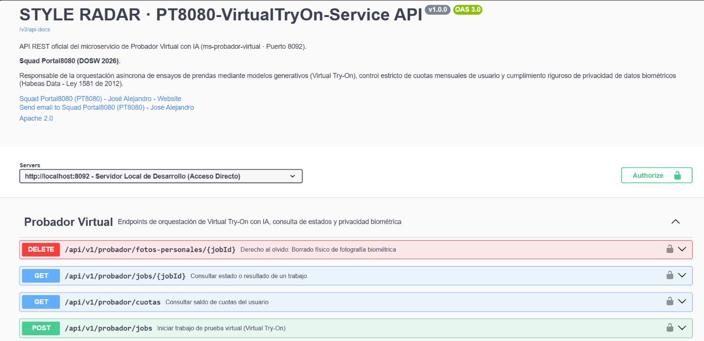

[⬅ Volver al README Principal](../../README.md)

---

## 3. ENDPOINTS Y ENLACE A SWAGGER

La documentación interactiva OpenAPI 3.0 y los contratos de ejecución se encuentran disponibles en los entornos del proyecto:

### Matriz Oficial de Enlaces por Entorno (PROD, QA, LOCAL)

| Entorno | Estado | Propósito | URL Base del Servicio | Swagger OpenAPI UI | Health Check |
| :------------------------------- | :----: | :-------------------------------------- | :---------------------------------------------------- | :---------------------------------------------------------------------------------------- | :--------------------------------------------------------------------------------------- |
| **Desarrollo Local (DEV)** | Active | Entorno local de desarrollo y Docker Compose (`probador_db`) | `http://localhost:8500` | [Swagger UI Local](http://localhost:8500/swagger-ui/index.html) | [`/actuator/health`](http://localhost:8500/actuator/health) |
| **Calidad / Pruebas (QA)** | Active (Sprint 2) | Pruebas integradas de Sprint y QA en Azure (`probador_db_qa`) | `https://styleradar-virtualtryon-qa.azurewebsites.net` | [`/swagger-ui/index.html`](https://styleradar-virtualtryon-qa.azurewebsites.net/swagger-ui/index.html) | [`/actuator/health`](https://styleradar-virtualtryon-qa.azurewebsites.net/actuator/health) |
| **Producción (PROD)** | Active (Sprint 2) | Despliegue productivo de StyleRadar en Azure (`probador_db_prod`) | `https://styleradar-virtualtryon-prod.azurewebsites.net` | [`/swagger-ui/index.html`](https://styleradar-virtualtryon-prod.azurewebsites.net/swagger-ui/index.html) | [`/actuator/health`](https://styleradar-virtualtryon-prod.azurewebsites.net/actuator/health) |

* **Especificación OpenAPI (JSON Contrato):** `http://localhost:8500/v3/api-docs`

<div align="center">
  
  <p><sub><b>Figura 3.1:</b> Documentación interactiva Swagger OpenAPI UI activa en <code>http://localhost:8500/swagger-ui/index.html</code> evidenciando contratos REST de orquestación VTON, endpoints de cuotas, privacidad y autenticación Bearer JWT.</sub></p>
</div>

### Tabla de Endpoints Expuestos

| Método | Endpoint | Descripción | Rol Requerido | Códigos HTTP |
| :--------: | :--------------------------- | :----------------------------------------------------------- | :------------ | :--------------------------------: |
| `POST` | `/api/v1/try-on/consents` | Otorga o actualiza el consentimiento biométrico (Ley 1581) (`SR-RF-107`) | `COMPRADOR`, `USER`, `ADMIN` | `201`, `400`, `401`, `403` |
| `GET` | `/api/v1/try-on/consents/{userId}` | Consulta el estado del consentimiento biométrico del usuario (`SR-RF-107`) | `COMPRADOR`, `USER`, `ADMIN` | `200`, `401`, `403`, `404` |
| `DELETE` | `/api/v1/try-on/consents/{userId}` | Revoca el consentimiento biométrico y elimina la silueta activa (`SR-RF-107`) | `COMPRADOR`, `USER`, `ADMIN` | `200`, `401`, `403`, `404` |
| `POST` | `/api/v1/try-on/photos` | Carga y valida la fotografía frontal (`JPEG`/`PNG`, $\le 5\text{ MB}$, $\ge 300\times 400\text{ px}$ vertical) (`SR-RF-23`) | `COMPRADOR`, `USER`, `ADMIN` | `201`, `400`, `401`, `403`, `413`, `422` |
| `GET` | `/api/v1/try-on/photos/{userId}` | Consulta metadatos y URL firmada de solo lectura (`sp=r`) de la silueta (`SR-RF-23`) | `COMPRADOR`, `USER`, `ADMIN` | `200`, `401`, `403`, `404` |
| `GET` | `/api/v1/try-on/quotas` | Consulta cuotas mensuales consumidas y disponibles en PostgreSQL + Redis (`SR-RF-108`) | `COMPRADOR`, `USER`, `ADMIN` | `200`, `401`, `403` |
| `GET` | `/api/v1/try-on/garments/{garmentId}/validate` | Valida compatibilidad de categoría de prenda y disponibilidad de cuota (`SR-RF-24`) | `COMPRADOR`, `USER`, `ADMIN` | `200`, `400`, `401`, `403`, `429` |
| `POST` | `/api/v1/try-on/jobs` | Inicia y procesa un trabajo de prueba virtual con IA (`FashnAiStrategy` / `MockAiStrategy`) (`SR-RF-25`) | `COMPRADOR`, `USER`, `ADMIN` | `202`, `400`, `401`, `403`, `422`, `429`, `504` |
| `GET` | `/api/v1/try-on/jobs/{jobId}` | Consulta el estado o resultado renderizado con URL SAS renovada (`SR-RF-26`) | `COMPRADOR`, `USER`, `ADMIN` | `200`, `401`, `403`, `404` |
| `GET` | `/api/v1/try-on/jobs` | Consulta el historial de trabajos de prueba virtual del usuario (`SR-RF-109`) | `COMPRADOR`, `USER`, `ADMIN` | `200`, `401`, `403` |
| `DELETE` | `/api/v1/try-on/personal-photos/{jobId}` | Elimina irreversiblemente silueta y resultado por Derecho al Olvido (Ley 1581) (`SR-RF-27`) | `COMPRADOR`, `USER`, `ADMIN` | `204`, `401`, `403`, `404` |
| `GET` | `/actuator/health` | Health Check y estado operativo de BD, Redis y RabbitMQ | Público | `200` |

<details>
<summary><b>Click para ver Ejemplos Interactivos de Request y Response JSON (Payloads)</b></summary>

<br>

#### Ejemplo 1: Iniciar Prueba Virtual (`POST /api/v1/try-on/jobs`)

```bash
curl -X POST "http://localhost:8500/api/v1/try-on/jobs" \
  -H "Content-Type: application/json" \
  -H "Authorization: Bearer <JWT_TOKEN>" \
  -d '{
    "userId": "a1b2c3d4-e5f6-7890-abcd-ef1234567890",
    "garmentId": "f1e2d3c4-b5a6-7890-1234-567890abcdef",
    "photoUrl": "https://styleradarblob.blob.core.windows.net/photos/user-pose-01.jpg",
    "biometricConsent": true
  }'
```

##### Respuesta Exitosa (`202 Accepted`):

*Cabecera HTTP retornada:* `Location: /api/v1/try-on/jobs/018e3a2b-3333-7000-8000-000000000001`

```json
{
  "jobId": "018e3a2b-3333-7000-8000-000000000001",
  "userId": "a1b2c3d4-e5f6-7890-abcd-ef1234567890",
  "garmentId": "f1e2d3c4-b5a6-7890-1234-567890abcdef",
  "status": "QUEUED",
  "resultImageUrl": null,
  "executionTimeMs": null,
  "createdAt": "2026-11-02T12:00:00Z"
}
```

#### Ejemplo 2: Consultar Cuotas del Usuario (`GET /api/v1/try-on/quotas`)

```bash
curl -X GET "http://localhost:8500/api/v1/try-on/quotas?userId=a1b2c3d4-e5f6-7890-abcd-ef1234567890" \
  -H "Authorization: Bearer <JWT_TOKEN>"
```

##### Respuesta (`200 OK`):

```json
{
  "userId": "a1b2c3d4-e5f6-7890-abcd-ef1234567890",
  "monthlyLimit": 10,
  "usedCount": 3,
  "remainingCount": 7,
  "billingPeriod": "2026-11"
}
```

#### Ejemplo 3: Respuesta de Error Estándar RFC 7807 (`ProblemDetail`)

```json
{
  "type": "https://styleradar.edu.dosw/errors/quota-exceeded",
  "title": "Cuota de Pruebas Excedida",
  "status": 429,
  "detail": "El usuario ha alcanzado el límite de pruebas virtuales permitido en su plan.",
  "instance": "/api/v1/try-on/jobs"
}
```

</details>

---

[⬅ Volver al README Principal](../../README.md)
