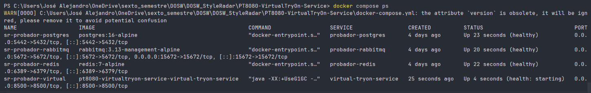

[⬅ Volver al README Principal](../../README.md)

---

## 6. CÓMO EJECUTAR LOCAL Y CON DOCKER

### Prerrequisitos de Entorno

* **Java Development Kit (JDK):** Versión 21 LTS instalada (`java -version`).
* **Apache Maven:** Versión 3.9+ instalada (`mvn -version`) o uso del wrapper `./mvnw`.
* **Docker Engine & Docker Compose:** Versión 24+ en ejecución (`docker --version`).

### Ejecución Local con Maven (Perfil Dev)

```bash
# 1. Clonar el repositorio
git clone https://github.com/StyleRadar1/PT8080-VirtualTryOn-Service.git
cd PT8080-VirtualTryOn-Service

# 2. Levantar la infraestructura auxiliar con Docker Compose (PostgreSQL, Redis, RabbitMQ)
docker compose up -d postgres redis rabbitmq

# 3. Ejecutar el microservicio localmente en el puerto 8500
./mvnw clean spring-boot:run -Dspring-boot.run.profiles=dev
```

### Ejecución Contenerizada Completa con Docker Compose

El repositorio incluye un archivo `docker-compose.yml` que orquesta la infraestructura completa junto al microservicio:

<details>
<summary><b>Click para ver Instrucciones de Docker y Contenedores Orquestados</b></summary>

<br>

```bash
# Levantar todos los servicios en segundo plano (build multi-stage del microservicio + DB + Redis + RabbitMQ)
docker compose up -d --build

# Verificar el estado de los contenedores
docker compose ps

# Visualizar logs en tiempo real del microservicio
docker compose logs -f virtual-tryon-service

# Detener los servicios
docker compose down
```

#### Puertos Expuestos en la Red Docker:

* **Microservicio Virtual Try-On:** `http://localhost:8500`
* **PostgreSQL (probador_db):** `localhost:5442` (mapeado a 5432 interno)
* **Redis Server:** `localhost:6389` (mapeado a 6379 interno)
* **RabbitMQ AMQP Broker:** `localhost:5672`
* **RabbitMQ Management Dashboard:** `http://localhost:15672` (usuario: `guest`, clave: `guest`)

</details>

### Comprobación de Salud (Health Check)

```bash
curl -s http://localhost:8500/actuator/health
# Esperado: {"status":"UP"}
```

<div align="center">
  
  <p><sub><b>Figura 6.1:</b> Ejecución de <code>docker compose ps</code> verificando los 4 contenedores OCI levantados y en estado saludable (healthy): <code>sr-probador-virtual</code> (:8500), <code>sr-probador-postgres</code> (:5442), <code>sr-probador-redis</code> (:6389) y <code>sr-probador-rabbitmq</code> (:5672/15672).</sub></p>
</div>

---

[⬅ Volver al README Principal](../../README.md)
