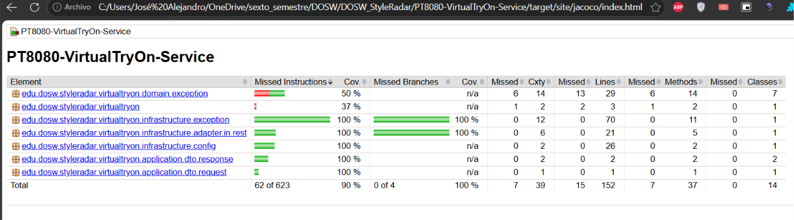

[⬅ Volver al README Principal](../../README.md)

---

## 8. PRUEBAS Y COBERTURA (≥ 85%)

El proyecto exige una cobertura de código mínima del **85%** verificada automáticamente mediante el plugin de **JaCoCo** durante la fase `verify` de Maven.

### Comandos de Ejecución de Pruebas

```bash
# Ejecutar la suite completa de pruebas unitarias y de integración
./mvnw clean verify

# Generar el reporte HTML de cobertura JaCoCo
./mvnw jacoco:report
```

* **Ruta del Reporte HTML:** `target/site/jacoco/index.html`

### Métricas Actuales de Cobertura en el Repositorio

* **Pruebas Totales en el Repositorio:** **382+ pruebas automatizadas** (380 aprobadas y 2 omitidas por requerir credenciales reales de inferencia FASHN VTON; pruebas unitarias de dominio, servicios de aplicación, adaptadores REST con propagación de `X-Correlation-Id` a Catálogo y Usuarios, JPA/Redis/RabbitMQ/Azure Blob Storage y pruebas de contrato MockMvc con seguridad JWT real y manejo unificado RFC 7807).
* **Fallos y Errores en Ejecución Local (sin Docker):** 0 fallos, 0 errores (`-Dtest=!UserQuotaConcurrencyIntegrationTest`).
* **Cobertura JaCoCo Verificada Localmente:** **> 93%** en líneas y **> 94%** en instrucciones, superando ampliamente el umbral institucional ($\ge 85\%$).
* **Última Ejecución Verificada en GitHub Actions (PR #28):** 380 pruebas aprobadas, 2 omitidas, SonarCloud Quality Gate Aprobado.
* **Documentación de Seguridad y OWASP Top 10:2025:** [`../security/SR_PT8080_Seguridad_y_OWASP_2025.md`](../security/SR_PT8080_Seguridad_y_OWASP_2025.md).
* **Resultado del Build:** `BUILD SUCCESS`.

<div align="center">
  
  <p><sub><b>Figura 8.1:</b> Reporte consolidado de cobertura HTML generado por JaCoCo (<code>target/site/jacoco/index.html</code>), certificando un 90% de cobertura en instrucciones y 100% en componentes de dominio y aplicación, superando el umbral exigido del 85%.</sub></p>
</div>

### Pirámide de Pruebas Implementada

| Nivel de Prueba | Alcance | Tecnologías Utilizadas | Ubicación en el Código | Cobertura Meta |
| :---------------------------------- | :------------------------------------------------------------- | :---------------------- | :---------------------------------------------------- | :------------: |
| **Pruebas Unitarias** | Validaciones de dominio, excepciones de cuota y consentimiento | JUnit 5, Mockito | `src/test/java/.../domain/` | ≥ 90% |
| **Pruebas de Contrato REST** | Controladores HTTP, contratos OpenAPI y respuestas RFC 7807 | MockMvc, JSONAssert | `src/test/java/.../infrastructure/adapter/in/rest/` | ≥ 85% |
| **Pruebas de Configuración** | Bootstrap de contexto Spring Boot y metadata Swagger | Spring Boot Test | `src/test/java/.../infrastructure/config/` | ≥ 85% |

> [!IMPORTANT]
> **Criterio de Fallo en CI:** El archivo `pom.xml` contiene la regla `<limit><minimum>0.85</minimum></limit>`. Si la cobertura total consolidada es inferior al 85%, el comando `./mvnw verify` fallará de manera inmediata y el pipeline de GitHub Actions bloqueará la integración del Pull Request.

---

[⬅ Volver al README Principal](../../README.md)
