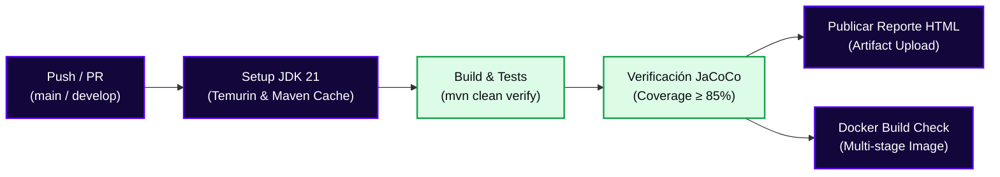
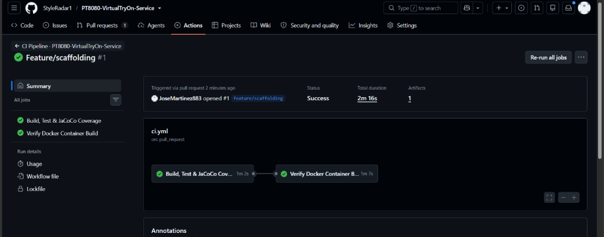

[⬅ Volver al README Principal](../../README.md)

---

## 9. CI/CD CON EL BADGE DEL PIPELINE

El ciclo de vida del microservicio implementa integración y despliegue continuo automatizado mediante **GitHub Actions** (`.github/workflows/ci.yml`, `.github/workflows/ci-qa.yml`, `.github/workflows/ci-prod.yml`) y análisis estático con **SonarCloud**.

### Badges de Pipelines y Calidad (GitHub Actions & SonarCloud)

  
  
  
  
  

### Matriz de Pipelines por Rama Protegida

| Pipeline | Rama / Entorno | Trigger | Quality Gate Requerido | Estado |
| :--- | :---: | :---: | :--- | :---: |
| **CI (`ci.yml`)** | `develop`, `main`, `feature/**` | Push / PR | Compilación + 288 Pruebas + JaCoCo ≥ 85% + SonarCloud + Docker Build |  |
| **CD QA (`ci-qa.yml`)** | `develop` *(Azure QA · `probador_db_qa`)* | Push / Manual | Tests + SonarCloud + Push Docker Hub (`qa-latest`) + Deploy Azure QA |  |
| **CD PROD (`ci-prod.yml`)** | `main` / `v*.*.*` *(Azure PROD · `probador_db_prod`)* | Push / Tag | Tests + SonarCloud + Push Docker Hub (`latest`) + Deploy Azure PROD |  |
| **SonarQube Gate** | `main`, `develop`, `feature/**` | Push / PR | 0 Bugs + 0 Vulnerabilidades + JaCoCo ≥ 85% (`Quality Gate A`) |  |

### Diagrama del Flujo Automatizado (Pipeline Stages)

### Estructura de Jobs en `.github/workflows/ci.yml`:

1. **`build-and-test`:**
   - Ejecuta sobre `ubuntu-latest` con JDK 21 Temurin y caché de dependencias Maven.
   - Ejecuta `./mvnw clean verify -B` garantizando la compilación y la meta JaCoCo $\ge 85\%$.
   - Sube como artefacto descargable del pipeline el reporte HTML consolidado de cobertura (`jacoco-coverage-report`).
2. **`docker-build-check`:**
   - Depende del éxito de `build-and-test`.
   - Verifica la construcción exitosa de la imagen OCI multi-stage a partir del `Dockerfile` sin publicar a registros externos.

  
  
<b>Figura 9.1:</b> Ejecución exitosa del pipeline automatizado de CI en GitHub Actions para el Pull Request hacia <code>develop</code> (#1), verificando compilación con JDK 21 Temurin, suite completa de pruebas unitarias/integración, Quality Gate JaCoCo y construcción de la imagen OCI multi-stage en Docker.

---

[⬅ Volver al README Principal](../../README.md)
