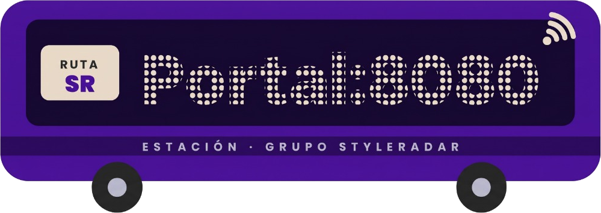
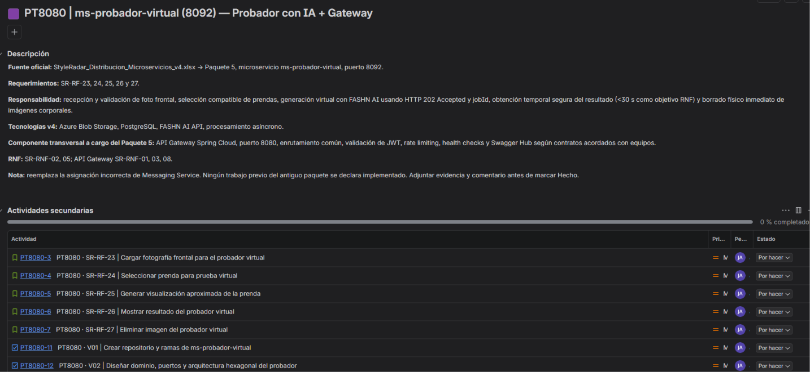

[⬅ Volver al README Principal](../../README.md)

---

## 12. EQUIPO, RESPONSABLES Y ENLACE A LA ÉPICA EN JIRA

### Equipo y Responsables del Microservicio

Desarrollado y mantenido por el **Squad Portal8080 (`PT8080`)** para la asignatura DOSW 2026.

  

| Rol | Nombre Completo | Usuario GitHub |
| :---: | :---: | :---: |
| **Líder del Equipo** | Daniel Valero Quiroga | [@DanielValeroQ](https://github.com/DanielValeroQ) |
| **Desarrollador Backend** | Jose Alejandro Martinez Arias | [@JoseMartinez883](https://github.com/JoseMartinez883) |
| **Desarrollador Backend** | Juan David Munar | [@JuanDavidMunar](https://github.com/JuanDavidMunar) |
| **Desarrollador Frontend** | Kevin | [@Kevin](https://github.com/StyleRadar1) |

---

### Enlaces de Gestión, Repositorios y Evidencias

El seguimiento de requerimientos, historias de usuario del Sprint y artefactos del proyecto se centraliza en los siguientes enlaces oficiales:

* **Repositorio Oficial en GitHub:** [https://github.com/StyleRadar1/PT8080-VirtualTryOn-Service](https://github.com/StyleRadar1/PT8080-VirtualTryOn-Service)
* **Organización Oficial de StyleRadar:** [https://github.com/StyleRadar1](https://github.com/StyleRadar1)
* **Épica Oficial del Microservicio (Jira):** [https://mail-team-nyjtgqcj.atlassian.net/browse/PT8080-1?atlOrigin=eyJpIjoiMWE0NjAzMTdkODI5NDFmN2I2ODdhOGYzNjJjMTU4ZTkiLCJwIjoiaiJ9](https://mail-team-nyjtgqcj.atlassian.net/browse/PT8080-1?atlOrigin=eyJpIjoiMWE0NjAzMTdkODI5NDFmN2I2ODdhOGYzNjJjMTU4ZTkiLCJwIjoiaiJ9)
* **Tablero Scrum del Squad (Jira):** [https://mail-team-nyjtgqcj.atlassian.net/jira/software/projects/PT8080/boards/74/backlog?epics=visible&selectedIssue=PT8080-38&atlOrigin=eyJpIjoiMjRlZW](https://mail-team-nyjtgqcj.atlassian.net/jira/software/projects/PT8080/boards/74/backlog?epics=visible&selectedIssue=PT8080-38&atlOrigin=eyJpIjoiMjRlZW)
* **Swagger UI Local (Puerto 8500):** [http://localhost:8500/swagger-ui/index.html](http://localhost:8500/swagger-ui/index.html)
* **Especificación OpenAPI JSON:** [http://localhost:8500/v3/api-docs](http://localhost:8500/v3/api-docs)

  
  
<b>Figura 12.1:</b> Épica oficial <code>PT8080-1</code> en Atlassian Jira para <code>ms-probador-virtual</code> (puerto 8500), detallando los 8 requerimientos funcionales oficiales (SR-RF-23 al 27 y SR-RF-107 al 109), RNF asociados y el desglose de historias de usuario y tareas técnicas del Sprint para el probador virtual asistido por IA.

### Requerimientos Funcionales Asignados

| Código RF | Nombre del Requerimiento | Actor Principal | Criterio de Aceptación Clave |
| :----------: | :---------------------------------------------------------------------- | :----------------- | :---------------------------------------------------------------------------------------------------------------- |
| `SR-RF-23` | Carga y validación de fotografía de silueta de usuario | Usuario Registrado | La imagen debe cargarse en formato JPG/PNG con dimensiones mínimas $300\times 400\text{ px}$ y tamaño $\le 5\text{ MB}$. |
| `SR-RF-24` | Selección de prenda de vestir y validación de compatibilidad de talla | Usuario Registrado | Valida categoría compatible (tops/bottoms/one-pieces), medidas corporales y disponibilidad de stock en el catálogo. |
| `SR-RF-25` | Generación y procesamiento asíncrono de prueba virtual con IA | Usuario Registrado | Encola la inferencia neuronal retornando HTTP 202 con cabecera `Location` y descontando cuota del periodo activo. |
| `SR-RF-26` | Consulta y visualización del resultado individual renderizado | Usuario Registrado | Entrega la URL firmada SAS renovada de solo lectura (`sp=r`) del render generado una vez el trabajo se completa. |
| `SR-RF-27` | Eliminación irreversible de fotografía de silueta (Derecho al Olvido) | Usuario Registrado | Garantiza el borrado físico del blob en Azure y marca `photo_purged = true` respondiendo HTTP 204 No Content. |
| `SR-RF-107` | Gestión de consentimiento biométrico para tratamiento de datos (Ley 1581) | Usuario Registrado | Permite otorgar, consultar y revocar la autorización explícita de tratamiento biométrico conforme a la Ley 1581. |
| `SR-RF-108` | Consulta de cuotas mensuales disponibles y consumidas | Usuario Registrado | Retorna el límite mensual (`FREE` = 10, `RADAR_PLUS` = 50), pruebas consumidas y saldo restante desde PostgreSQL + Redis. |
| `SR-RF-109` | Consulta del historial de pruebas virtuales del usuario | Usuario Registrado | Lista cronológicamente todos los trabajos de prueba virtual ejecutados por el usuario autenticado con su estado y fecha. |

---

[⬅ Volver al README Principal](../../README.md)
